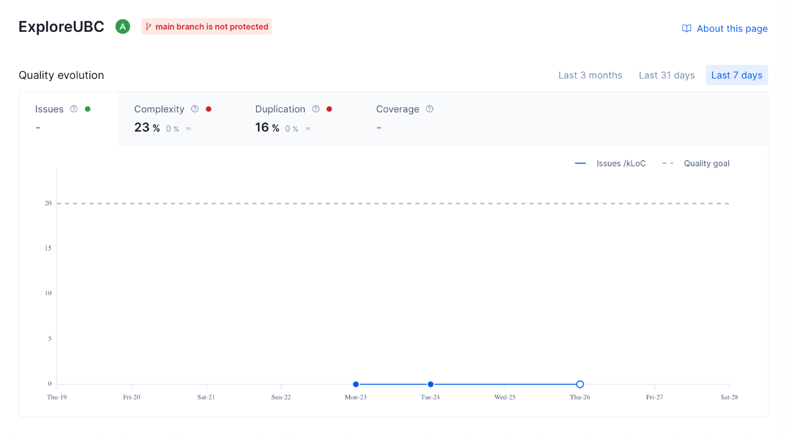

# Code Review

## 1. Change History

| **Change Date** | **Modified Sections** | **Rationale** |
| --------------- | --------------------- | ------------- |
| November 27, 2026 | 3.3 | Recorded responses to the peer review feedback |
| November 26, 2026 | 2.2 | Added the Codacy quality evolution screenshot as evidence for the reported issues status. |
| November 20, 2026 | 2.1–2.4, 3.2, 3.3 | Recorded the latest main-branch commit, marked the remaining Codacy issues as N/A, and documented the received peer-review results and security changes. |

---

## 2. Automated Code Review Results

### 2.1. Commit Hash Where Codacy Ran

`2d49911d92d8cdd6b28485639d9beebc736351c6`

### 2.2. Unfixed Issues per Codacy Category

N/A (no issues remaining)

The Codacy quality evolution view above shows the **Issues** no issue count.

### 2.3. Unfixed Issues per Codacy Code Pattern

N/A (no issues remaining)

### 2.4. Justifications for Unfixed Issues

N/A (no issues remaining)

---

## 3. Manual Code Review Results

### 3.1. Review You Performed

- **Peer group reviewed:** Trailmix
- **Commit SHA reviewed:** `6d12cd1496c569073a144350f8fe535b93f53d54`
- **Date the artifacts were exchanged:** Nov 4, 2026
- **Review report submitted:** [CP3_TrailMix_Review.pdf](./CP3_TrailMix_Review.pdf)

| **Section**          | **Item**                                                                                                                                             | **Score** |
| -------------------- | ---------------------------------------------------------------------------------------------------------------------------------------------------- | --------- |
| Manual code review | Code is maintainable, efficient, and handles error cases well | **8/10** |
| Manual test review | Tests are complete, errors and edge cases are thoroughly tested, and correct assertions are used | **8/10** |
| Manual test review | Test code is maintainable and well-structured | **8/10** |
| Manual test review | Test implementation matches the requirements and design | **7/10** |
| Manual test review | Non-functional requirements are tested well | **3/10** |
| Manual test review | Tests achieve high coverage and cases of less than 100% coverage are well-justified | **9/10** |
| Manual test review | All back-end tests can be run automatically | **8/10** |
| Automated code review| Codacy runs with the required setup                                                                                                                    | **10/10**      |
| Automated code review | All remaining Codacy issues are well-justified | **9/10** |
|  | **Total** | **70/90** |

**Major fault reported**

- **Description:** The backend has no request rate limiting or throttling at either the Express or Caddy layer. A single signed-in user can therefore send an unbounded number of authenticated Planner requests. Each accepted `POST /api/routes/plan` request can fan out into multiple Google Route Matrix and route-detail calls, including retries, so an attacker can consume the project's Google API quota, create unexpected API charges, and deny route planning to legitimate users. The same lack of throttling also applies to Google sign-in and all user-data endpoints. Neither `backend/src/app.ts`, `backend/package.json`, nor `deploy/Caddyfile` configures a rate limiter.
- **Steps to reproduce:**
  1. Run the backend and test MongoDB locally, then obtain a valid session token for a test account.
  2. Send a burst of concurrent authenticated requests to a cheap endpoint such as `GET /api/users/me`. This safely verifies the common middleware behavior without consuming Google quota.
  3. Record the response status of every request. The review reproduction sent 100 requests concurrently through `createApp()` and received `{"200":100}`: every request was accepted and none returned `429 Too Many Requests`.
  4. Inspect `backend/src/app.ts` and `deploy/Caddyfile`; there is no per-IP or per-session request limit, burst limit, or backoff response.
  5. The same authenticated path applies to `POST /api/routes/plan`. Do not load-test the deployed endpoint: repeated valid Planner requests would reach the billable Google Routes integration and demonstrate the damaging form of the vulnerability.
- **Screenshots:** The terminal reproduction output was `{"200":100}`, showing that all 100 concurrent requests succeeded with no `429` response. No graphical screenshot is required to establish the server behavior. Supporting code evidence is the absence of rate-limiting middleware in `backend/src/app.ts` and the unrestricted `reverse_proxy backend:3000` configuration in `deploy/Caddyfile`.
- **Severity:** **High.** Exploitation requires only a normal Google account and can affect every user by exhausting shared Google Routes quota or backend capacity. The attack is remotely repeatable, has no enforced request ceiling, and may also create financial impact through billable API calls. Recommended remediation is per-IP and per-session throttling, with a strict limit on `/api/auth/google` and `/api/routes/plan`, `429` responses with `Retry-After`, Google Cloud quota/budget alerts, and automated tests for burst rejection.

### 3.2. Review You Received

- **Reviewing group:** Trailmix (Timmy, Matthew, Payton, Adam)
- **Commit SHA that was reviewed:** `c8fa76d72ecaa6c403e29545cf280c3547885ad0`
- **Review report received:** [CP3_ExploreUBC_Review_REVISED.docx.pdf](../../../../CP3_ExploreUBC_Review_REVISED.docx.pdf)

| **Section**          | **Item**                                                                                                                                             | **Score** |
| -------------------- | ---------------------------------------------------------------------------------------------------------------------------------------------------- | --------- |
| Manual code review   | Code is maintainable, efficient, and handles error cases well | **3/10** |
| Manual test review   | Tests are complete, errors and edge cases are thoroughly tested, and correct assertions are used | **7/10** |
| Manual test review   | Test code is maintainable and well-structured | **8/10** |
| Manual test review   | Test implementation matches the requirements and design | **6/10** |
| Manual test review   | Non-functional requirements are tested well | **5/10** |
| Manual test review   | Tests achieve high coverage and cases of less than 100% coverage are well-justified | **8/10** |
| Manual test review   | All back-end tests can be run automatically | **9/10** |
| Automated code review | Codacy runs with the required setup | **6/10** |
| Automated code review | All remaining Codacy issues are well-justified | **3/10** |
| | **Total** | **55/90** |

**Major fault reported against your project**

- **Description:** The backend has no authentication or authorization. NFR1 in Requirements_and_Design.md requires the backend to verify the Google ID token (signature, issuer, audience, expiry) and issue a session credential, and the design section notes that the authentication endpoint, verification and session issuance "remain to be implemented". At the reviewed commit:
  - The backend trusts the URL. No middleware checks a token. Every route takes userId from the URL path, and the DAO's ownerId filter compares against that same value, so the ownership check does not protect anything. JWT_SECRET and GOOGLE_CLIENT_ID are listed in .env.example and the README, but no code in backend/src reads them.
  - Sign-in does not reach the backend. MainActivity.kt reads only the display name from the Google credential, shows it in a toast, and opens MainActivity2. The ID token is never sent to the backend.
  - Every user shares one account. MainActivity2.kt line 100 hard-codes userId = "6acd519c76376cefc61e97f1"; line 99, which read the ID from the intent, is commented out.
- **Severity:** Critical. Anyone who knows or guesses a user ID can read or change that user's profile, and read, create, edit or delete their itineraries, activities and transportation segments, without any credentials. Because the app uses one hard-coded identity, all real users also see and overwrite each other's data. An automated tool would not flag this: each file is well-formed and passes linting, and the fault only appears when the implementation is compared with NFR1.

### 3.3. Actions Taken in Response to the Review

| **Finding** | **Action Taken** | **Commit / Location in Git** |
| ----------- | ---------------- | ---------------------------- |
| Missing Google identity verification and account binding | Added a backend Google sign-in endpoint that verifies ID token claims and looks up or creates the user by Google subject. | [171bcbe](https://github.com/islamhampriv/ExploreUBC/commit/171bcbe0ca8efd3562dc980a900ee10095bccc6c), [792cd97](https://github.com/islamhampriv/ExploreUBC/commit/792cd97fa468a959dcda81368419a583aff057d8); [googleTokenVerifier.ts](../backend/src/auth/googleTokenVerifier.ts), [authRouter.ts](../backend/src/auth/authRouter.ts), [authService.ts](../backend/src/auth/authService.ts), [userDao.ts](../backend/src/users/userDao.ts) |
| Unauthenticated and cross-user access to user-scoped routes | Added bearer-session authentication and ownership middleware to the user and itinerary route tree; missing or invalid sessions receive `401`, and another user's ID receives `403`. | [e5bdacd](https://github.com/islamhampriv/ExploreUBC/commit/e5bdacdaa71664e7ed7df7872922f792d6621960), [4eb99dd](https://github.com/islamhampriv/ExploreUBC/commit/4eb99ddce38cfcf93b912e84934b3a09f7e26a9d); [index.ts](../backend/src/index.ts), [authMiddleware.ts](../backend/src/auth/authMiddleware.ts) |
| Missing secure session lifecycle | Added revocable server sessions, token-hash persistence, expiry checks and renewal; the Android app encrypts stored sessions and clears rejected sessions. | [171bcbe](https://github.com/islamhampriv/ExploreUBC/commit/171bcbe0ca8efd3562dc980a900ee10095bccc6c), [69ce773](https://github.com/islamhampriv/ExploreUBC/commit/69ce77357090acd43bd0cf9deab94013d6c2286f), [4eb99dd](https://github.com/islamhampriv/ExploreUBC/commit/4eb99ddce38cfcf93b912e84934b3a09f7e26a9d); [sessionService.ts](../backend/src/session/sessionService.ts), [sessionDao.ts](../backend/src/session/sessionDao.ts), [SessionStore.kt](../frontend/app/src/main/java/com/exploreUBC/cpen321application/data/auth/SessionStore.kt), [SessionStartupCoordinator.kt](../frontend/app/src/main/java/com/exploreUBC/cpen321application/data/auth/SessionStartupCoordinator.kt) |
| Google sign-in bypassed the backend and the app used a shared hard-coded user ID | Connected Android Google credentials to backend sign-in, used the authenticated session's user ID for app data, and sent the session on API requests. | [69ce773](https://github.com/islamhampriv/ExploreUBC/commit/69ce77357090acd43bd0cf9deab94013d6c2286f), [e5bdacd](https://github.com/islamhampriv/ExploreUBC/commit/e5bdacdaa71664e7ed7df7872922f792d6621960), [4eb99dd](https://github.com/islamhampriv/ExploreUBC/commit/4eb99ddce38cfcf93b912e84934b3a09f7e26a9d); [MainActivity.kt](../frontend/app/src/main/java/com/exploreUBC/cpen321application/MainActivity.kt), [MainActivity2.kt](../frontend/app/src/main/java/com/exploreUBC/cpen321application/MainActivity2.kt), [AuthRepository.kt](../frontend/app/src/main/java/com/exploreUBC/cpen321application/data/auth/AuthRepository.kt), [ApiClient.kt](../frontend/app/src/main/java/com/exploreUBC/cpen321application/data/network/ApiClient.kt) |
| Missing security tests | Added mocked and database-backed auth/session tests plus Android session-restoration and real-backend missing-session/cross-user tests. | [4eb99dd](https://github.com/islamhampriv/ExploreUBC/commit/4eb99ddce38cfcf93b912e84934b3a09f7e26a9d), [247f3cc](https://github.com/islamhampriv/ExploreUBC/commit/247f3ccb4ed1444ecb42947a0a7e6bb257afc6f2); [auth.test.ts (mock)](../backend/tests/mock/auth/auth.test.ts), [auth.test.ts (no mock)](../backend/tests/no-mock/auth/auth.test.ts), [session.test.ts (mock)](../backend/tests/nfr/mock/session/session.test.ts), [session.test.ts (no mock)](../backend/tests/nfr/no-mock/session/session.test.ts), [SessionRestorationNfrTest.kt](../frontend/app/src/androidTest/java/com/exploreUBC/cpen321application/nfr/SessionRestorationNfrTest.kt), [AuthorizationNfrTest.kt](../frontend/app/src/androidTest/java/com/exploreUBC/cpen321application/nfr/AuthorizationNfrTest.kt) |
| Obsolete Vercel deployment and Atlas-only initializer | Removed the Vercel deployment configuration and dependencies and the Atlas-only database initializer. Replaced the deployment path with an EC2 workflow and production Docker Compose using its MongoDB service; removed the obsolete `db:init` instruction. | [c1d93d3](https://github.com/islamhampriv/ExploreUBC/commit/c1d93d35c125f9ed2c37b30d2968bb7a0c7381c7); [deploy.yml](../.github/workflows/deploy.yml), [docker-compose.deploy.yml](../docker-compose.deploy.yml), [README.md](../README.md) |
| Unused sample map data and static map fallback | Removed the sample map data and static fallback from the Android map flow so map content comes from the configured services and failures are visible. | [8da8c5b](https://github.com/islamhampriv/ExploreUBC/commit/8da8c5bfdf6adbee5611331065a5e6fa24911737); [CampusMapController.kt](../frontend/app/src/main/java/com/exploreUBC/cpen321application/ui/map/CampusMapController.kt), [MapRoute.kt](../frontend/app/src/main/java/com/exploreUBC/cpen321application/ui/map/MapRoute.kt) |
