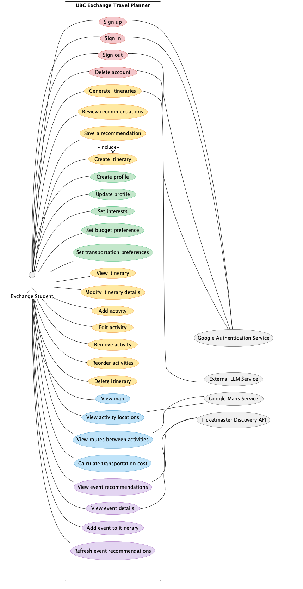
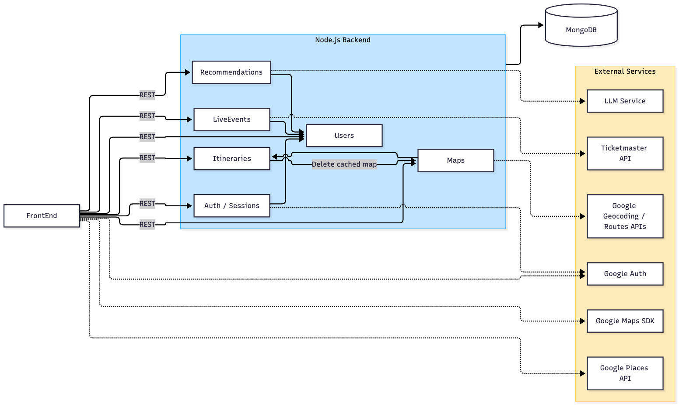
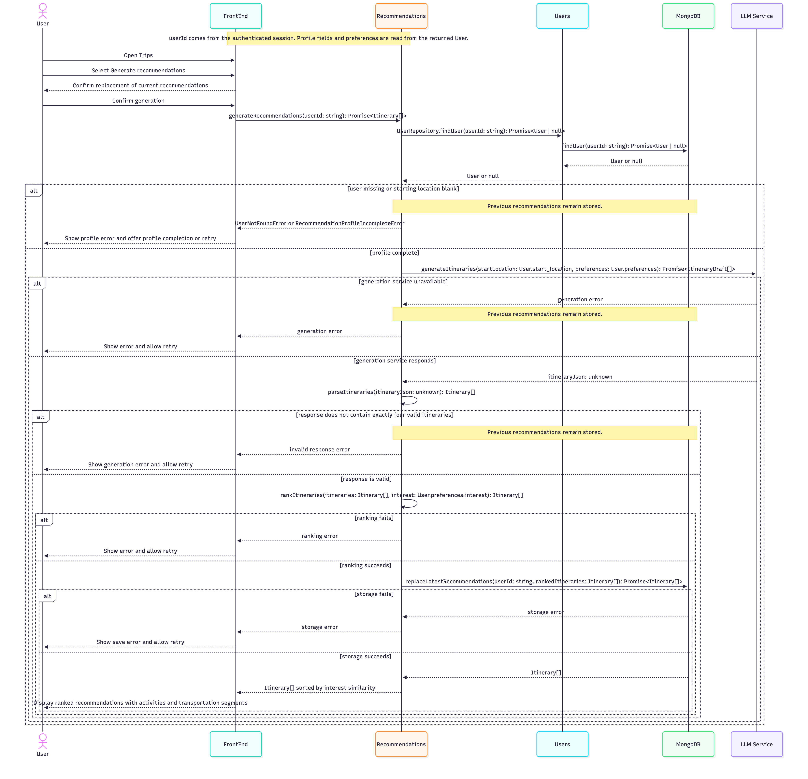
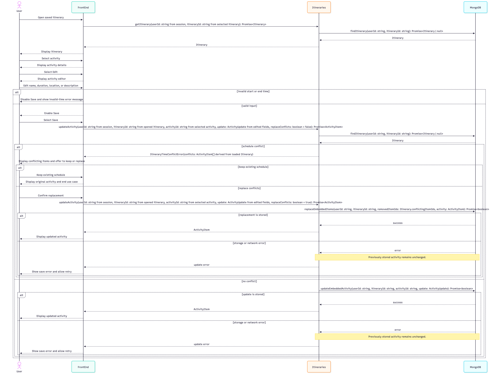
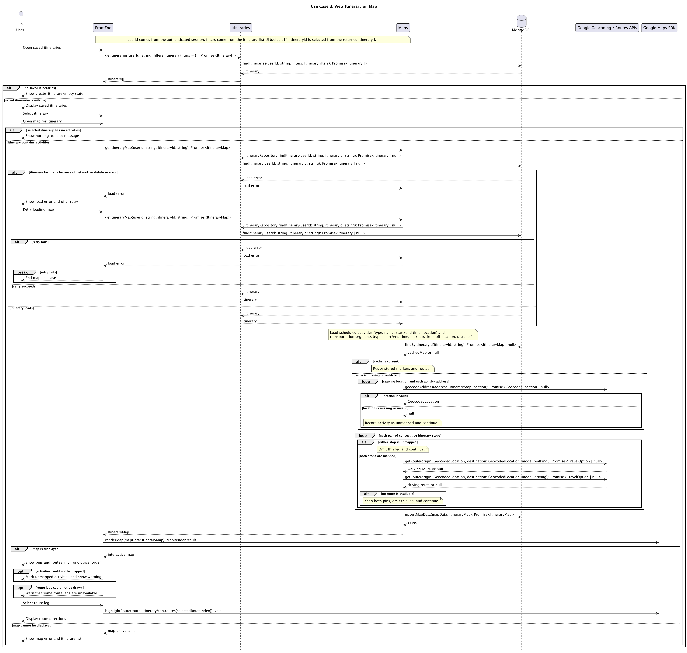
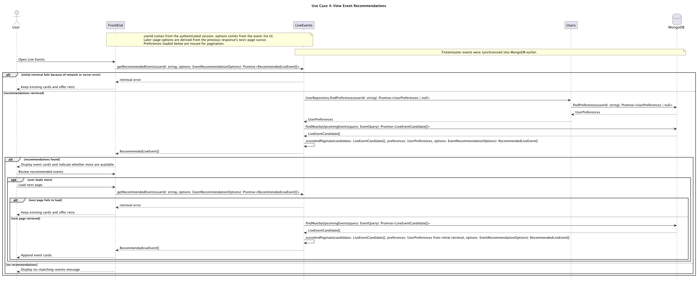
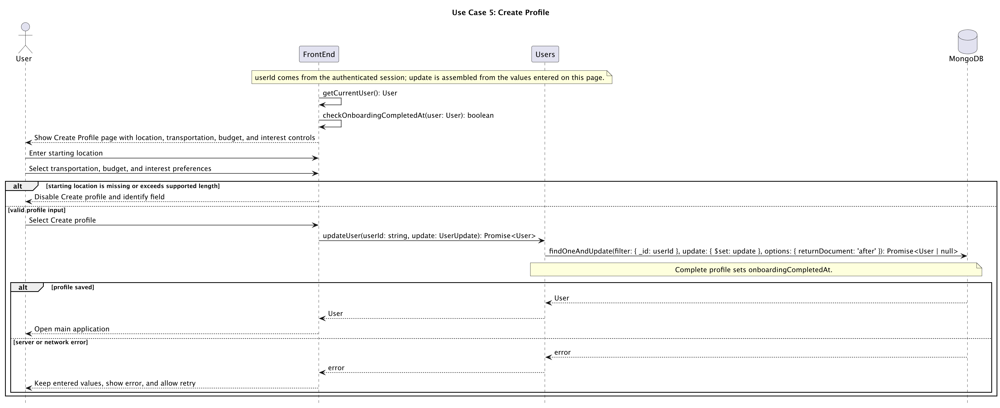

# Requirements and Design

## 1. Change History

| **Change Date**  | **Modified Sections** | **Rationale**                                                                                                                                                        |
| ---------------- | --------------------- | -------------------------------------------------------------------------------------------------------------------------------------------------------------------- |
| November 26, 2026 | 2, 3.1–3.5, 4.1, 4.6 | Removed an unsupported itinerary operation from the requirements and diagram; aligned recommendation inputs, behavior, interface signatures, and sequence diagrams with the implementation and dependency components. |
| November 20, 2026 | 3.1, 3.4, 3.7, 4.1, 4.7 | Separated functional Google Authentication from the Security NFR and aligned the Security design with session restoration, renewal, hash-only persistence, and ownership enforcement. |
| October 1, 2026  | 3.3, 3.4, 3.5         | Added actors, use case descriptions, and formal use case specifications for Feature Sets 2 and 3.                                                                    |
| October 14, 2026 | 4.1, 4.3, 4.4         | Added main components and interfaces from the View Itinerary on Map sequence diagram, plus the Google Maps API and project frameworks. |
| November 19, 2026 | 3.4, 3.5             | Added the Create Profile first-login use case and its formal specification.                                                                                           |

---

## 2. Project Description

Our project is called Explore UBC - a travel itinerary planner for UBC users who want to explore British Columbia. It is an Android application built with Kotlin and JetPack Compose for the front-end, Node.js for the backend, and MongoDB for the database.

Planning a trip often means finding ideas, checking routes, and building a schedule. Travellers can sign up to create a profile with their interests, budget preference, and preferred transportation mode. They can also update their profile at any time. Our application uses Google Credential manager for authentication and session management.

The central use case is creating an itinerary. Travellers can add activities and transportation to their itinerary. At any time, they can also edit or remove these activities and transportation segments when those plans change. They can also request AI itinerary recommendations based on their profile. External LLMs provide the ideas, but our backend owns the final recommendation logic. This is the technical highlight of our project.

After adding activities, travellers can view activity locations on a map and see routes between them. The map also features pins for popular destinations nearby. Google Maps SDK supports these features.

Finally, travellers can view live event recommendations. Local events are retrieved from an external event service API and are matched to the user’s location and profile preferences. While the application is open, it refreshes recommendations after the user moves at least 10 km or saves updated preferences and displays an in-app notification when the recommendations change.

The features in this app will facilitate the entire trip planning process for UBC Users, from choosing where to go and to getting there, leaving little room for unwanted surprises and making the journey a breeze.

---

## 3. Requirements Specification

### **3.1. List of Features**

1. **Itinerary Recommendation**: Generates and ranks itinerary recommendations using the user's saved profile and preferences.
2. **Itinerary Management**: Allows users to create, view, modify, and delete saved itineraries and their activities or transportation segments.
3. **User Profile**: Stores user details and preferences used to personalize itineraries and live-event recommendations.
4. **Authentication**: Signs users in or up with Google, connects them to their ExploreUBC account, and signs them out by revoking the current ExploreUBC session.
5. **Google Maps Integration**: Displays itinerary routes, activity locations, and popular nearby locations on an interactive map.
6. **Live Events**: Retrieves upcoming events from Ticketmaster and recommends them using the user's interest and location.

### **3.2. Use Case Diagram**



### **3.3. Actors Description**

1. **User**: The primary user of ExploreUBC. An incoming or current UBC user who plans trips around campus and Vancouver, maintains a travel profile, creates itineraries, views maps, and receives live event recommendations.
2. **Google Maps Service**: An external mapping service that supplies map tiles, geocoded activity coordinates, transportation routes between itinerary stops, and popular nearby locations.
3. **Ticketmaster Discovery API**: An external event service that supplies upcoming event details, venues, locations, prices, images, and ticket links used to generate live-event recommendations.
4. **Google Authentication Service**: An external identity service that authenticates users with Google and provides identity credentials for the backend to validate.
5. **External LLM Service**: An external AI service that generates candidate itinerary content from the user's saved profile and preferences.

### **3.4. Use Case Description**

#### Use Cases for Feature 1: Itinerary Recommendation

1. **Generate Itineraries**: The user can generate four ranked itinerary recommendations based on their saved profile.
2. **Review Recommendations**: The user reviews the latest generated itineraries and compares their activities, schedules, transportation segments, and rankings.
3. **Save a Recommendation**: The user selects a generated recommendation to save.

#### Use Cases for Feature 2: Itinerary Management

1. **Create an Itinerary**: The user creates a blank saved itinerary and provides its basic details.
2. **View an Itinerary**: The user opens a saved itinerary and reviews its details and scheduled items.
3. **Modify Itinerary Details**: The user changes an itinerary's name or description.
4. **Add an Activity**: The user adds an activity to a saved itinerary.
5. **Add a Transportation Segment**: The user adds a transportation segment to a saved itinerary.
6. **Remove an Activity**: The user removes an activity from a saved itinerary.
7. **Remove a Transportation Segment**: The user removes a transportation segment from a saved itinerary.
8. **Edit an Activity**: The user changes an activity's name, description, location, or time.
9. **Edit a Transportation Segment**: The user changes a transportation segment's mode or timing.
10. **Delete an Itinerary**: The user permanently removes a saved itinerary.

#### Use Cases for Feature 3: User Profile

1. **Create Profile**: On first login, the user enters a starting location and selects transportation, budget, and interest preferences. The system saves the profile before opening the main application.
2. **Update Profile**: The user changes their display name, starting location, or transportation, budget, and interest preferences.
3. **Set Interests**: The user selects interests used to personalize future itinerary and live-event recommendations.
4. **Set Budget Preference**: The user selects the default budget used for future itinerary recommendations.
5. **Set Transportation Preference**: The user selects the preferred transportation mode used for future itinerary recommendations.

#### Use Cases for Feature 4: Authentication

1. **Sign In with Google**: The user signs in with Google to access their existing ExploreUBC account.
2. **Sign Up with Google**: A first-time user signs up with Google to create an ExploreUBC account. Signing in again with the same Google account opens that ExploreUBC account.
3. **Sign Out**: The user signs out of ExploreUBC and returns to the authentication screen. Accessing their account again requires signing in.

#### Use Cases for Feature 5: Google Maps Integration

1. **View Itinerary on Map**: The user selects a saved itinerary and the system plots its activity locations and connecting transportation routes on an interactive Google Map.
2. **View Routes Between Activities**: The user selects an itinerary route leg and the system highlights its route and displays its directions.
3. **Browse Popular Locations**: The user opens the map and the system displays pins for popular locations in the current map region so the user can inspect them and consider adding them to a trip.

#### Use Cases for Feature 6: Live Events

1. **View Event Recommendations**: The user views upcoming events ranked using their saved interests and current location. The user can load additional recommendations when more matching events are available.
2. **View Event Details**: The user reviews an event's title, description, date, venue, distance, and available price information, and can open its Ticketmaster page for complete details.
3. **Add an Event to an Itinerary**: The user selects or creates an itinerary, confirms or changes the event's suggested end time, and adds the event as a scheduled activity. If the event overlaps with existing itinerary items, the user can keep the existing schedule or replace the conflicting items with the event.
4. **Refresh Event Recommendations**: While the application is open, the system refreshes recommendations when the user moves at least 10 km or saves updated preferences. If the recommendations change while the user is viewing another screen, the system displays an in-app notification that can open Live Events.

### **3.5. Formal Use Case Specifications (5 Most Major Use Cases)**

#### Use Case 1: Generate Itineraries

**Description**: The user can generate four ranked itinerary recommendations based on their saved profile.

**Primary actor(s)**: User

**Main success scenario**:
1. The user opens Trips, where their saved profile provides the starting location and preferences.
2. The user selects **Generate recommendations** and confirms replacement of the current recommendations in a confirmation dialog.
3. The system loads the user's saved profile and generates four candidate itineraries.
4. The system validates, ranks, and saves the four itineraries as the latest recommendations.
5. The system displays the recommendations with their activities, transportation segments, and rankings.

**Failure scenario(s)**:

- 3a. The saved profile has no starting location or the user cannot be found.
  - 3a1. The system leaves the previous recommendations unchanged.
  - 3a2. The system reports the profile error so the user can complete their profile or retry.
- 3b. The external generation service is unavailable or does not return exactly four valid itineraries.
  - 3b1. The system rejects the response and leaves the previous recommendations unchanged.
  - 3b2. The system informs the user that generation failed and allows another attempt.
- 4a. Ranking or storage fails.
  - 4a1. The system reports the failure and allows another attempt.

#### Use Case 2: Edit an Activity

**Description**: The user changes an activity's name, description, location, or duration.

**Primary actor(s)**: User

**Main success scenario**:

1. The user opens a saved itinerary.
2. The user selects an activity.
3. The system displays the activity's details.
4. The user selects `Edit`.
5. The user edits the activity's name, duration, location, or description.
6. The user selects `Save`.
7. The system saves and displays the updated activity.

**Failure scenario(s)**:

- 5a. The user enters an invalid start or end time.
  - 5a1. The system disables **Save**.
  - 5a2. The system displays an error message.
- 6a. The updated activity overlaps with one or more existing activities or transportation segments.
  - 6a1. The system displays the conflicting itinerary items and asks the user whether to keep the existing schedule or replace the conflicting items.
  - 6a2. If the user keeps the existing schedule, the original activity and conflicting items remain unchanged, and the use case ends.
  - 6a3. If the user chooses replacement, the system removes the conflicting items and saves the updated activity.
- 7a. The activity update cannot be stored because of a server or network error.
  - 7a1. The system leaves the previously saved activity unchanged.
  - 7a2. The system informs the user that the update failed and allows another attempt.

#### Use Case 3: View Itinerary on Map

**Description**: The user visualizes a selected trip itinerary on a map, including activity pins and transportation routes between consecutive activities.

**Primary actor(s)**: User

**Preconditions**: The user has already been verified.

**Main success scenario**:

1. The user opens ExploreUBC and navigates to their saved itineraries.
2. The user selects the itinerary they want to visualize.
3. The user opens the map view for that itinerary.
4. The system loads the itinerary's scheduled activities (type, name, start/end time, location) and transportation segments (type, start/end time, pick-up/drop-off location, distance).
5. The system places the itinerary locations on the map and determines the routes between consecutive activities.
6. The system displays an interactive map with activity pins in chronological order and routes drawn between consecutive activities.
7. The user selects a route leg.
8. The system highlights the selected route and displays its directions.

**Failure scenario(s)**:

- 2a. The user has no saved itineraries.
  - 2a1. The system shows an empty-state message explaining that an itinerary must be created first.
  - 2a2. The use case ends.
- 2b. The selected itinerary contains no activities.
  - 2b1. The system informs the user that the itinerary has nothing to plot.
  - 2b2. The use case ends.
- 4a. The system cannot load itinerary data because of a network or database error.
  - 4a1. The system displays an error and offers a retry action.
  - 4a2. If retry succeeds, the use case resumes at step 4. Otherwise, the use case ends.
- 5a. One or more activities have a missing or invalid location.
  - 5a1. The system shows the activities that have a usable location and marks the others as not shown on the map.
  - 5a2. The system warns the user that some activities could not be shown on the map.
  - 5a3. The use case continues with the remaining activities that can be shown.
- 5b. A route between two consecutive activities is unavailable.
  - 5b1. The system still shows both activity pins and omits only that route.
  - 5b2. The system notifies the user that this transportation leg could not be drawn.
  - 5b3. The use case continues with the remaining routes.
- 6a. The system cannot display the interactive map.
  - 6a1. The system displays a map-unavailable message and offers the existing list view of the itinerary.

#### Use Case 4: View Event Recommendations

**Description**: The user views upcoming events ranked using their saved interest and current location. The user can load additional recommendations when more results are available.

**Primary actor(s)**: User

**Preconditions:**

- The user has a saved interest preference.
- The application can provide the user's current location or a default location.
- The system has a catalog of upcoming events available for recommendations.

**Main success scenario**:

1. The user opens the live-events feature.
2. The system retrieves the user's saved interest preference and location, ranks nearby upcoming events, and displays the first page of event cards with their relevant information.
3. The user reviews the recommended events.
4. The system indicates whether more recommendations are available.
5. The user requests the next page when they want to view more recommendations.
6. The system retrieves and displays the additional recommendations.

**Failure scenario(s)**:

- 2a. The recommendations cannot be retrieved because of a network or server error.
  - 2a1. The application keeps any recommendations already displayed and allows the user to retry.
- 2b. No stored events satisfy the location and recommendation threshold.
  - 2b1. The system informs the user that no matching events are currently available.
- 6a. The next page cannot be loaded.
  - 6a1. The system keeps the existing event cards visible and allows the user to retry.

#### Use Case 5: Create Profile

**Description**: A first-time user creates an ExploreUBC profile by entering a starting location and selecting the preferences used to personalize itinerary and live-event recommendations.

**Primary actor(s)**: User

**Preconditions**:

- The user has successfully signed in with Google.
- The authenticated account has not completed profile creation.

**Main success scenario**:

1. The system detects that profile creation is required after the user's first login.
2. The system displays the Create Profile page with a starting-location field and transportation, budget, and interest preference controls.
3. The user enters a starting location.
4. The user selects transportation, budget, and interest preferences.
5. The user selects **Create profile**.
6. The system validates and saves the starting location and preferences, marks profile creation complete, and opens the main application.

**Failure scenario(s)**:

- 5a. The starting location is missing or exceeds the supported length.
  - 5a1. The system disables **Create profile** and identifies the invalid field.
- 6a. The profile cannot be saved because of a server or network error.
  - 6a1. The system keeps the entered values on the page, displays an error, and allows another attempt.

**Postcondition:** The user's starting location and preferences are saved, profile creation is marked complete, and subsequent logins open the main application.

### **3.6. Screen Mock-ups**

### **3.7. Non-Functional Requirements**

1. <a id="nfr1"></a>**Security**
   - **Description**: On application startup, a stored ExploreUBC session must be restored only when the backend validates it; a valid restored session must have its expiry renewed. Missing, malformed, unknown, expired, or revoked sessions must be rejected, and an expired session must be removed from persistence. The backend must store only a cryptographic hash of each session token. Every protected user-scoped request must be authenticated, and a session for one user must receive `403 Forbidden` when it requests a resource owned by another user. When restoration is rejected with `401 Unauthorized`, the frontend must clear the stored session and return to the authentication screen.
   - **Justification**: Session validation, renewal, revocation, hash-only persistence, and ownership enforcement prevent a previously issued or cross-user credential from granting unauthorized access after authentication has completed.
2. <a id="nfr2"></a>**Accessibility**
   - **Description**: Users must be able to find and open all four main sections (Events, Trips, Map, and Profile), including when they use a screen reader or larger text. This is checked in three ways:
     1. **Screen reader labels**: TalkBack, Android's built-in screen reader, must announce the correct destination name for each of the four navigation items.
     2. **Touch targets**: Each navigation item must have a tappable area of at least 48 × 48 dp (density-independent pixels), the size recommended by Android for touch controls.
     3. **Larger text**: When Android's font size is set to 200%, all four navigation labels must remain visible and each item must still be usable.
   - **Justification**: TalkBack is the screen reader provided for Android, so testing with it directly checks whether users who rely on spoken feedback can navigate this Android app. The Web Content Accessibility Guidelines (WCAG) are accessibility guidelines published by the World Wide Web Consortium (W3C) and provide a recognized benchmark for clear control names, usable touch targets, and text that can be enlarged (WCAG 2.2 criteria 4.1.2, 2.5.8, and 1.4.4, respectively). Android's 48 dp recommendation gives a platform-specific, measurable touch target. Together, these checks make the app's main sections easier to identify and access.

---

## 4. Designs Specification

### **4.1. Main Components**

Backend signatures use TypeScript notation; the two Android map-client signatures use Kotlin notation.

1. **Itineraries**
   - **Purpose and rationale**: Owns the saved-itinerary aggregate, including itinerary details, activities, transportation segments, conflict resolution, and deletion. These operations are grouped because they enforce the same ownership and scheduling rules in one component.
   - **Interfaces**:
     1. `createItinerary(userId: string, itinerary: CreateItineraryInput): Promise<Itinerary>`
        - **Purpose [3.4.2.1]**: Creates a saved itinerary for a user.
     2. `getItineraries(userId: string, filters: ItineraryFilters = {}): Promise<Itinerary[]>`
        - **Purpose [3.4.2.2]**: Lists a user's saved itineraries.
     3. `getItineraryDetails(userId: string, itineraryId: string): Promise<ItineraryDetails>`
        - **Purpose [3.4.2.2]**: Retrieves one saved itinerary's editable details.
     4. `getItinerary(userId: string, itineraryId: string): Promise<Itinerary>`
        - **Purpose [3.4.2.2]**: Retrieves one saved itinerary.
     5. `updateItineraryDetails(userId: string, itineraryId: string, details: ItineraryDetailsUpdate): Promise<Itinerary>`
        - **Purpose [3.4.2.3]**: Updates a saved itinerary's editable details.
     6. `addActivity(userId: string, itineraryId: string, activityInput: CreateActivityInput, replaceConflicts = false): Promise<ActivityItem>`
        - **Purpose [3.4.2.4]**: Adds an activity and optionally replaces conflicting items.
     7. `addTransportationSegment(userId: string, itineraryId: string, segmentInput: CreateTransportationInput, replaceConflicts = false): Promise<TransportationItem>`
        - **Purpose [3.4.2.5]**: Adds a transportation segment and optionally replaces conflicting items.
     8. `removeActivity(userId: string, itineraryId: string, activityId: string): Promise<boolean>`
        - **Purpose [3.4.2.6]**: Removes an activity.
     9. `removeTransportationSegment(userId: string, itineraryId: string, segmentId: string): Promise<boolean>`
        - **Purpose [3.4.2.7]**: Removes a transportation segment.
     10. `updateActivity(userId: string, itineraryId: string, activityId: string, update: ActivityUpdate, replaceConflicts = false): Promise<ActivityItem>`
         - **Purpose [3.4.2.8]**: Updates an activity and optionally replaces conflicts.
     11. `updateTransportationSegment(userId: string, itineraryId: string, segmentId: string, update: TransportationSegmentUpdate, replaceConflicts = false): Promise<TransportationItem>`
         - **Purpose [3.4.2.9]**: Updates a transportation segment and optionally replaces conflicts.
     12. `deleteItinerary(userId: string, itineraryId: string): Promise<boolean>`
         - **Purpose [3.4.2.10]**: Deletes a saved itinerary.
2. **Users**
   - **Purpose and rationale**: Owns account identity, authentication state, profile fields, and personalization preferences. These concerns are grouped around the user lifecycle and share the same authorization boundary; centralizing them also gives `Recommendations` and `LiveEvents` one authoritative source for profile data.
   - **Interfaces**:
     1. `getUser(userId: string): Promise<User>`
        - **Purpose [3.4.3.1, 3.4.3.2]**: Retrieves a user's complete profile and profile-creation state.
     2. `updateUser(userId: string, update: UserUpdate): Promise<User>`
        - **Purpose [3.4.3.1–3.4.3.5]**: Creates or updates editable profile fields and preferences and returns the complete user.
     3. `authenticateWithGoogle(idToken: string): Promise<GoogleAuthResult>`
        - **Purpose [3.4.4.1, 3.4.4.2]**: Verifies a Google identity and returns the associated user and ExploreUBC session.
     4. `getCurrentSession(sessionToken: string): Promise<CurrentSessionResult>`
        - **Purpose [NFR1]**: Restores a valid authenticated session and refreshes its expiry.
     5. `logout(sessionToken: string): Promise<void>`
        - **Purpose [3.4.4.3]**: Revokes the current session.
3. **LiveEvents**
   - **Purpose and rationale**: Owns Ticketmaster synchronization, event normalization, nearby-event filtering, and personalized event ranking. This logic is isolated because it depends on an external provider and geospatial/time-based rules with a refresh cadence separate from saved-itinerary operations.
   - **Interfaces**:
     1. `syncEvents(repository: EventRepository): Promise<{ pageCount: number; eventCount: number; matchedCount: number; modifiedCount: number; upsertedCount: number; expiredCount: number; staleCount: number }>`
        - **Purpose [3.4.6.1]**: Retrieves available Ticketmaster pages, maps the results, upserts events, and removes expired or stale events after a successful complete sync.
     2. `getRecommendedEvents(userId: string, options: EventRecommendationOptions): Promise<RecommendedLiveEvent[]>`
        - **Purpose [3.4.6.1]**: Retrieves, scores, filters, sorts, and paginates personalized event recommendations.
4. **Recommendations**
   - **Purpose and rationale**: Owns the recommendation pipeline from profile-aware generation through validation, ranking, and publication of the latest recommendation set. These steps are grouped because they form one consistency boundary: invalid or incomplete generated candidates must never replace the user's last valid recommendations.
   - **Interfaces**:
     1. `findLatestRecommendations(userId: string): Promise<Itinerary[]>`
        - **Purpose [3.4.1.2]**: Retrieves the user's latest recommendation set.
     2. `generateRecommendations(userId: string): Promise<Itinerary[]>`
        - **Purpose [3.4.1.1]**: Generates itinerary recommendations using the user's stored profile.
5. **Maps:**
   - **Purpose and rationale**: Owns map-specific translation of itinerary locations into markers and routes, plus cache reuse and invalidation. Geocoding, directions, and provider fallbacks are grouped here to shield the rest of the application from Google Maps details and to keep partial-location and unavailable-route behavior consistent.
   - **Interfaces**:
     1. `getItineraryMap(userId: string, itineraryId: string): Promise<ItineraryMap>`
        - **Purpose [3.4.5.1]**: Returns current cached map data or generates new markers and routes for an itinerary.
     2. `deleteItineraryMap(itineraryId: string): Promise<void>`
        - **Purpose [3.4.2.10]**: Deletes cached map data after its itinerary is deleted.
     3. `fun autocompleteAddresses(query: String): AddressAutocompleteResult`
        - **Purpose [3.4.5.1]**: Retrieves Google Places address suggestions for itinerary locations.
     4. `fun fetchPopularPlaces(center: LatLng): List<PopularPlace>?`
        - **Purpose [3.4.5.3]**: Returns popular locations near the selected map region, or `null` when unavailable.

### **4.2. Databases**

1. **Users**
   - **Purpose**: Represents an application user, profile-creation state, and personalization preferences in ExploreUBC.
   ```javascript
       type User = {
           _id: ObjectId;
           googleSubject: string;
           email: string;
           displayName: string;
           profileImageUrl: string | null;
           start_location: string;
           preferences: {
               transportation: {
                   mode: 'walking' | 'cycling' | 'transit' | 'driving' | 'other';
               };
               budget: 'economical' | 'balanced' | 'premium';
               interest: 'food' | 'art' | 'outdoors' | 'markets' | 'live_music' | 'gaming';
           };
           onboardingCompletedAt: Date | null;
           create_at: Date;
           updated_at: Date;
       };
   ```
2. **Sessions**
   - **Purpose**: Stores revocable ExploreUBC sessions. Only the SHA-256 token hash is persisted; the raw session token is returned to the client only when the session is created.
   ```javascript
       type Session = {
           _id: ObjectId;
           userId: ObjectId;
           tokenHash: string;
           createdAt: Date;
           expiresAt: Date;
       };
   ```
3. **Itineraries**
   - **Purpose**: Represents a saved itinerary

   ```javascript
       type Itinerary = {
           id: string;
           ownerId: string;
           name: string;
           description?: string;
           startingLocation?: string;
           items: ItineraryItem[]:{
               type ActivityItem = {
                   id: string;
                   name: string;
                   description?: string;
                   category?: string;
                   location: string;
                   startTime: string;
                   endTime: string;
                   };

                   type TransportationItem = {
                   id: string;
                   mode: 'walking' | 'cycling' | 'transit' | 'driving' | 'other';
                   startLocation: string;
                   endLocation: string;
                   distance_m: number;
                   startTime: string;
                   endTime: string;
                   };
           };
           createdAt: string;
           updatedAt: string;
           saved: boolean;
           inRecommendation: boolean;
           score: {
               // fields that contribute to the score calculation
           }
       };
   ```

4. **Live Events**
   - **Purpose**: Stores normalized Ticketmaster events for synchronization, nearby searches, and recommendation scoring.
   ```javascript
       type LiveEvent = {
           externalId: string;
           title: string;
           description?: string;
           imageUrl: string;
           startDateTime: Date;
           endDateTime?: Date;
           venueName: string;
           city: string;
           location: {
               type: "Point";
               coordinates: [number, number]; // longitude, latitude
           };
           category: string;
           ticketUrl: string;
           priceMin?: number;
           priceMax?: number;
           currency?: string;
           lastSyncedAt: Date;
       };
   ```

### **4.3. External Modules**

1. **Ticketmaster Discovery API**
   - **Purpose**: Supplies upcoming event listings for the configured city, province, and country. The backend retrieves paginated results, retries temporary failures, and converts provider responses into the internal `LiveEvent` format.

2. **Google Maps API**
   - **Purpose**: External mapping service used by ExploreUBC for the Feature Set 2 map view. The Android Maps SDK draws the interactive map, activity pins, popular-location pins, and routes. The API keys also support Directions (walking routes between itinerary stops) and Places Nearby Search (popular locations). When Maps or Places fails, the map view displays an error instead of sample locations or a substitute image.

### **4.4. Frameworks and Libraries**

1. **Kotlin / Android SDK**
   - **Purpose**: Language and platform for the ExploreUBC mobile client, including activities, layouts, and location permissions.
   - **Reason**: The course requires an Android application, and Kotlin is the standard language for the Android toolchain used in this project.
2. **Jetpack Compose and Material 3**
   - **Purpose**: Declarative UI toolkit used for Compose-based screens such as the health-check activity.
   - **Reason**: Compose is the current Android UI stack in the project template and works with the pinned AndroidX Compose BOM.
3. **Google Play services Maps SDK**
   - **Purpose**: Client library that embeds Google Maps in the app and exposes `MapView` / `GoogleMap` for pins, polylines, and camera control.
   - **Reason**: Feature Set 2 requires an in-app map rather than only opening the external Google Maps app.
4. **Node.js, TypeScript, and Express**
   - **Purpose**: Runtime, language, and HTTP framework for the backend API (for example the health endpoint and future itinerary/location services).
   - **Reason**: The course backend template uses Express on Node 22 with TypeScript, which matches the Itinerary Service and Location Service in the sequence diagrams.
5. **Gradle / Android Gradle Plugin**
   - **Purpose**: Builds the Android app and injects configuration such as `API_BASE_URL` and `MAPS_API_KEY` from `local.properties`.
   - **Reason**: It is the required Android build system and keeps secrets out of source control.
6. **Jest**
   - **Purpose**: Test runner for backend interface and non-functional tests.
   - **Reason**: It is the backend testing framework specified by the course template.
7. **MongoDB Node.js Driver**
   - **Purpose**: Stores events and performs geospatial, date, and user-preference queries.
   - **Reason**: It supports GeoJSON `2dsphere` indexes, upserts, and the MongoDB database already used by the project.

### **4.5. Dependencies Diagram**



### **4.6. Use Case Sequence Diagram (5 Most Major Use Cases)**

#### 4.6.1. [**Generate Itineraries**](#use-case-1-generate-itineraries)



#### 4.6.2. [**Edit Activities**](#use-case-2-edit-an-activity)



#### 4.6.3. [**View itinerary on map**](#use-case-3-view-itinerary-on-map)



#### 4.6.4. [**View Event Recommendations**](#use-case-4-view-event-recommendations)



#### 4.6.5. [**Create Profile**](#use-case-5-create-profile)



### **4.7. Design of Non-Functional Requirements**

1. **[Security](#nfr1)**
   - **Implementation**: [SessionStore.kt](../frontend/app/src/main/java/com/exploreUBC/cpen321application/data/auth/SessionStore.kt) encrypts the locally persisted ExploreUBC session with an Android Keystore-backed key. At startup, [SessionStartupCoordinator.kt](../frontend/app/src/main/java/com/exploreUBC/cpen321application/data/auth/SessionStartupCoordinator.kt) loads the stored session and asks [AuthRepository.kt](../frontend/app/src/main/java/com/exploreUBC/cpen321application/data/auth/AuthRepository.kt) to restore it through `GET /api/v1/auth/session`; sessions near expiry are renewed through the credential-based renewal path. A backend `401 Unauthorized` clears both the persisted session and the in-memory session before returning the application to its signed-out state. On the backend, [sessionService.ts](../backend/src/session/sessionService.ts) hashes tokens before repository access, validates expiry, removes expired sessions, and rolls a restored session's expiry forward. [authMiddleware.ts](../backend/src/auth/authMiddleware.ts) authenticates protected requests and compares the authenticated user ID with the `:userId` route parameter, returning `403 Forbidden` for cross-user access. [authService.ts](../backend/src/auth/authService.ts) revokes a session whose user no longer exists. Authentication itself—including Google credential verification, account creation or lookup, session issuance, and sign-out—is the functional behavior of use cases 3.4.4.1 through 3.4.4.3 rather than part of this NFR.
2. **[Accessibility](#nfr2)**
   - **Implementation**: In [MainActivity2.kt](../frontend/app/src/main/java/com/exploreUBC/cpen321application/MainActivity2.kt), the visible text labels for Events, Trips, Map, and Profile were retained, and each navigation icon's `contentDescription` was set to the same destination name so TalkBack announces a useful label. Every navigation item has a minimum interactive size of 48 x 48 dp through the Material navigation component. Emulator testing confirmed that each destination was announced and could be activated with TalkBack and that all four labels remained visible and usable without overlap or clipping at 200% Android font scaling.
