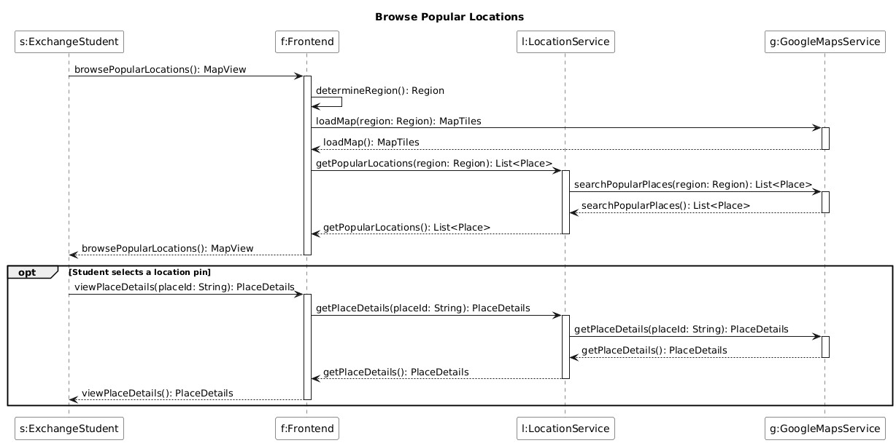

# Requirements and Design

## 1. Change History

| **Change Date**  | **Modified Sections** | **Rationale**                                                                                                                                                        |
| ---------------- | --------------------- | -------------------------------------------------------------------------------------------------------------------------------------------------------------------- |
| October 1, 2026  | 3.3, 3.4, 3.5         | Added actors, use case descriptions, and formal use case specifications for Feature Sets 2 and 3.                                                                    |
| October 14, 2026 | 4.1, 4.3, 4.4         | Added main components and interfaces from the View Itinerary on Map and Browse Popular Locations sequence diagrams, plus the Google Maps API and project frameworks. |

---

## 2. Project Description

[WRITE_PROJECT_DESCRIPTION_HERE]

---

## 3. Requirements Specification

### **3.1. List of Features**

### **3.2. Use Case Diagram**

### **3.3. Actors Description**

1. **Exchange Student**: The primary user of ExploreUBC. An incoming or current UBC exchange student who plans trips around campus and Vancouver, maintains a travel profile, creates itineraries, views maps, estimates transportation costs, and receives live event recommendations.
2. **Google Maps Service**: An external mapping service that supplies map tiles, geocoded activity coordinates, transportation routes between itinerary stops, and popular nearby locations.
3. **Event Information Service**: An external or backend-fed source of upcoming local events (for example concerts, shows, and campus events) used to generate in-app live recommendations.

### **3.4. Use Case Description**

- Use cases for feature 1: [WRITE_FEATURE_1_NAME_HERE]

1. **[WRITE_NAME_HERE]**: ...
2. **[WRITE_NAME_HERE]**: ...

- Use cases for feature set 2: Google Maps Integration and Transportation Budget Calculator

1. **View Itinerary on Map**: The exchange student selects a saved itinerary and the system plots its activity locations and connecting transportation routes on an interactive Google Map.
2. **Browse Popular Locations**: The exchange student opens the map and the system displays pins for popular locations in the current map region so the student can inspect them and consider adding them to a trip.

### **3.5. Formal Use Case Specifications (5 Most Major Use Cases)**

The five specifications below are the major use cases for Feature Sets 2 and 3.

#### Use Case 1: View Itinerary on Map

**Description**: The exchange student visualizes a selected trip itinerary on Google Maps, including activity pins and transportation routes between consecutive activities.

**Primary actor(s)**: Exchange Student

**Main success scenario**:

1. The exchange student opens ExploreUBC and navigates to their saved itineraries.
2. The exchange student selects the itinerary they want to visualize.
3. The exchange student opens the map view for that itinerary.
4. The system loads the itinerary's scheduled activities (type, name, start/end time, location) and transportation segments (type, start/end time, pick-up/drop-off location, distance).
5. The system requests geocoded coordinates, map tiles, and route polylines from the Google Maps Service.
6. The Google Maps Service returns valid coordinates, map data, and routes for the itinerary.
7. The system displays the map with activity pins in chronological order and drawn routes between consecutive activities.
8. The exchange student pans, zooms, and taps pins to inspect activity and route details.

**Failure scenario(s)**:

- 1a. The exchange student is not authenticated.
  - 1a1. The system prompts the student to sign in.
  - 1a2. After successful authentication, the use case resumes at step 1. Otherwise, the use case ends.
- 2a. The student has no saved itineraries.
  - 2a1. The system shows an empty-state message explaining that an itinerary must be created first.
  - 2a2. The use case ends.
- 2b. The selected itinerary contains no activities.
  - 2b1. The system informs the student that the itinerary has nothing to plot.
  - 2b2. The use case ends.
- 4a. The system cannot load itinerary data because of a network or database error.
  - 4a1. The system displays an error and offers a retry action.
  - 4a2. If retry succeeds, the use case resumes at step 4. Otherwise, the use case ends.
- 5a. One or more activities have a missing or invalid location.
  - 5a1. The system plots the activities that can be geocoded and marks the invalid stops as unmapped.
  - 5a2. The system warns the student that some activities could not be shown on the map.
  - 5a3. The use case continues with the remaining mapped activities.
- 6a. The Google Maps Service is unavailable or returns an error.
  - 6a1. The system displays a map-unavailable message and offers the existing list view of the itinerary.
  - 6a2. The use case ends.
- 6b. A route cannot be computed between two consecutive activities.
  - 6b1. The system still shows both activity pins and omits only the failed route segment.
  - 6b2. The system notifies the student that this transportation leg could not be drawn.
  - 6b3. The use case continues with the remaining routes.

#### Use Case 2: Browse Popular Locations

**Description**: The exchange student views popular locations as pins on the map for the current region (UBC campus, the itinerary area, or the student's surroundings) and inspects a pin for details.

**Primary actor(s)**: Exchange Student

**Main success scenario**:

1. The exchange student opens the map or explore view in ExploreUBC.
2. The system determines the map region to display, using the selected itinerary area, the student's current location, or a default UBC campus region.
3. The system requests popular locations in that region from the Google Maps Service.
4. The Google Maps Service returns a set of popular places with names, categories, and coordinates.
5. The system displays those places as pins on the map.
6. The exchange student taps a pin.
7. The system shows the location's name, category, and address, and offers an option to add it to an itinerary.

**Failure scenario(s)**:

- 1a. The exchange student is not authenticated.
  - 1a1. The system prompts the student to sign in.
  - 1a2. After successful authentication, the use case resumes at step 1. Otherwise, the use case ends.
- 2a. The student has denied location permission and no itinerary region is available.
  - 2a1. The system defaults the map region to the UBC campus area.
  - 2a2. The use case continues at step 3.
- 3a. The Google Maps Service request fails or times out.
  - 3a1. The system attempts to show any previously cached popular locations for the region.
  - 3a2. If cached data exists, the use case continues at step 5 with a stale-data notice. Otherwise, the system reports that popular locations could not be loaded and the use case ends.
- 4a. No popular locations are returned for the region.
  - 4a1. The system shows the map without popular-location pins and informs the student that none were found nearby.
  - 4a2. The use case ends.
- 6a. The selected pin's details cannot be loaded.
  - 6a1. The system displays an error that the location details are unavailable.
  - 6a2. The pin remains on the map and the use case ends for that selection.

### **3.6. Screen Mock-ups**

### **3.7. Non-Functional Requirements**

1. **[WRITE_NAME_HERE]**
  - **Description**: ...
    - **Justification**: ...
2. ...

---

## 4. Designs Specification

### **4.1. Main Components**

1. **Maps:**
  - **Purpose**: The Android client that the exchange student uses. It renders the map view, plots itinerary and popular-location pins, and forwards map and place requests to the backend services and Google Maps. It also loads a saved itinerary and assembles the map data (activity coordinates and transportation routes) needed to plot that itinerary. It also finds popular places in a map region and loads details when the student selects a popular-location pin.
  - **Interfaces**:
  a. `viewItineraryMap(itineraryId: UUID): MapView`
    - **Purpose**: Opens the map for a selected itinerary and returns the map view with activity pins and routes.
    b. `viewActivityDetails(activityId: UUID): ActivityDetails`
    - **Purpose**: Shows the details of an itinerary activity when the student taps an activity pin.
    c. `browsePopularLocations(): MapView`
    - **Purpose**: Opens the map in the current region and returns the map view with popular-location pins.
    d. `viewPlaceDetails(placeId: String): PlaceDetails`
    - **Purpose**: Shows the name, category, and address of a popular location when the student taps a location pin.
    e. `loadMap(region: Region): MapTiles`
    - **Purpose**: Requests map tiles for the chosen region from the Google Maps Service (used by both View Itinerary on Map and Browse Popular Locations).
    f. `getItineraryMapData(itineraryId: UUID): MapData`
    - **Purpose**: Returns the map data for the selected itinerary, including geocoded activities and route polylines.
    g. `getItinerary(itineraryId: UUID): Itinerary`
    - **Purpose**: Reads the itinerary record (activities and transport segments) from the Itinerary DB.
    h. `getCoordinatesAndRoutes(activities: List<Activity>, segments: List<TransportSegment>): MapData`
    - **Purpose**: Asks the Google Maps Service to geocode activity locations and compute routes between consecutive stops.
    i. `getPopularLocations(region: Region): List<Place>`
    - **Purpose**: Returns popular places for the given region so the Frontend can show them as pins.
    j. `searchPopularPlaces(region: Region): List<Place>`
    - **Purpose**: Queries the Google Maps Service for popular places in the region.
    k. `getPlaceDetails(placeId: String): PlaceDetails`
    - **Purpose**: Returns the details of a selected place, fetching them from the Google Maps Service when needed.

### **4.2. Databases**

1. **[WRITE_NAME_HERE]**
  - **Purpose**: ...
2. ...

### **4.3. External Modules**

1. **Google Maps API**
  - **Purpose**: External mapping service used by ExploreUBC for the Feature Set 2 map view. The Android Maps SDK draws the interactive map, activity pins, popular-location pins, and routes. The same API key also supports Directions (walking routes between itinerary stops), Places Nearby Search (popular locations), and Static Maps (fallback image if live tiles do not load).

### **4.4. Frameworks and Libraries**

1. **Kotlin / Android SDK**
  - **Purpose**: Language and platform for the ExploreUBC mobile client, including activities, layouts, and location permissions.
    - **Reason**: The course requires an Android application, and Kotlin is the standard language for the Android toolchain used in this project.
2. **Jetpack Compose and Material 3**
  - **Purpose**: Declarative UI toolkit used for Compose-based screens such as the health-check activity.
    - **Reason**: Compose is the current Android UI stack in the project template and works with the pinned AndroidX Compose BOM.
3. **Google Play services Maps SDK**
  - **Purpose**: Client library that embeds Google Maps in the app and exposes `MapView` / `GoogleMap` for pins, polylines, and camera control.
    - **Reason**: Feature Set 2 requires an in-app map rather than only opening the external Google Maps app.
4. **Node.js, TypeScript, and Express**
  - **Purpose**: Runtime, language, and HTTP framework for the backend API (for example the health endpoint and future itinerary/location services).
    - **Reason**: The course backend template uses Express on Node 22 with TypeScript, which matches the Itinerary Service and Location Service in the sequence diagrams.
5. **Gradle / Android Gradle Plugin**
  - **Purpose**: Builds the Android app and injects configuration such as `API_BASE_URL` and `MAPS_API_KEY` from `local.properties`.
    - **Reason**: It is the required Android build system and keeps secrets out of source control.
6. **Jest**
  - **Purpose**: Test runner for backend interface and non-functional tests.
    - **Reason**: It is the backend testing framework specified by the course template.

### **4.5. Dependencies Diagram**

### **4.6. Use Case Sequence Diagram (5 Most Major Use Cases)**

1. **[[Use Case 1: View itinerary on map]](#uc1)**
  
2. **[[Use Case 2: Browse Popular Location]](#uc2)**
  

### **4.7. Design of Non-Functional Requirements**

1. **[[WRITE_NAME_HERE]](#nfr1)**
  - **Implementation**: ...
2. ...

