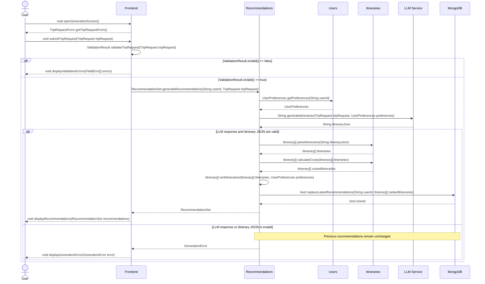
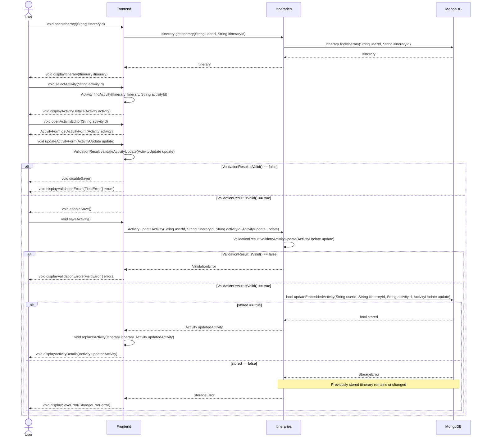

# Requirements and Design

## 1. Change History

| **Change Date**   | **Modified Sections** | **Rationale** |
| ----------------- | --------------------- | ------------- |
| _Nothing to show_ |

---

## 2. Project Description

[WRITE_PROJECT_DESCRIPTION_HERE]

---

## 3. Requirements Specification

### **3.1. List of Features**


### **3.2. Use Case Diagram**


### **3.3. Actors Description**
1. **[WRITE_NAME_HERE]**: ...
2. **[WRITE_NAME_HERE]**: ...

### **3.4. Use Case Description**
#### Use Cases for Feature 1: Itinerary Recommendation

1. **Generate Itineraries**: The user can generate four ranked itinerary recommendations based on trip constraints and profile preferences.
2. **Review Recommendations**: The user reviews the latest generated itineraries and compares their activities, schedules, transportation segments, and rankings.
3. **Save a Recommendation**: The user selects a generated recommendation to save.

#### Use Cases for Feature 2: Itinerary Management

1. **Create an Itinerary**: The user creates a blank saved itinerary and provides its basic details.
2. **Modify Itinerary Details**: The user changes an itinerary's name or description.
3. **Add Activities or Transportation Segments**: The user adds an activity or transportation segment to a saved itinerary.
4. **Remove Activities or Transportation Segments**: The user removes an activity or transportation segment from a saved itinerary.
5. **Reorder Activities or Transportation Segments**: The user changes the order of activities and their associated transportation segments.
6. **Edit Activities or Transportation Segments**: The user changes details such as an activity's name, description, location, or time, or a transportation segment's mode and timing.
7. **Delete an Itinerary**: The user permanently removes a saved itinerary.
8. **View an Itinerary on the Map**: The user views the itinerary's activity locations and transportation routes on a map.

#### Use Cases for Feature 3: User Profile

1. **Update Preferences**: The user selects preferred transportation modes for future itinerary recommendations. The user sets or changes the default budget used for future recommendations. The user selects interests, such as food, art, or outdoor activities, that the system uses to personalize future itinerary and live-event recommendations.

#### Use Cases for Feature 4: Authentication

1. **Sign In with Google**: The user authenticates with Google, and the backend validates the Google identity before granting access to the associated ExploreUBC account.
2. **Sign Up with Google**: A first-time user authenticates with Google, after which the system creates an ExploreUBC account linked to the validated Google identity.
3. **Sign Out**: The user ends the current ExploreUBC session and returns to the authentication screen.

### **3.5. Formal Use Case Specifications (5 Most Major Use Cases)**
<a name="uc1"></a>

#### Use Case 1: Generate Itineraries (Feature 1)

**Description**: The user can generate four ranked itinerary recommendations based on trip constraints and profile preferences.

**Primary actor(s)**: User
    
**Main success scenario**:
1. The user opens the itinerary-generation screen.
2. The user enters a starting location, available time, budget, transportation mode, and any request-specific interests or constraints.
3. The user selects **Generate Itineraries**.
4. The system generates and ranks four feasible candidate itineraries.
5. The system displays the four recommendations with their activities, transportation segments and rankings.

**Failure scenario(s)**:
- 3a. One or more required trip inputs are missing or invalid.
    - 3a1. The system identifies the invalid fields.
    - 3a2. The user corrects the inputs and submits the request again.
- 4a. An external generation or place-resolution service is unavailable or returns invalid data.
    - 4a1. The system does not replace the user's previous recommendation set.
    - 4b2. The system informs the user that recommendations could not be generated and allows another attempt.
- 4b. Fewer than four feasible itineraries satisfy the user's constraints.
    - 4b1. The system displays the feasible itineraries that were found.
    - 4b2. The system suggests relaxing the time, transportation, or interest constraints.

<a name="uc2"></a>

#### Use Case 2: Edit an Activity (Feature 2)

**Description**: The user changes an activity's name, description, location, or duration.

**Primary actor(s)**: User

**Main success scenario**:
1. The user opens a saved itinerary.
2. The user selects an activity.
3. The system displays the activity's details.
4. The user selects `Edit`.
5. The user edits the activity's name, duration, location, or description.
6. The user selects `Save`.
7. The system saves and displays the updated activity.

**Failure scenario(s)**:
- 5a. The user enters an invalid start or end time.
    - 5a1. The system disables **Save**.
    - 5a2. The system displays an error message.
- 6a. The activity update cannot be stored because of a server or network error.
    - 6a1. The system leaves the previously saved activity unchanged.
    - 6a2. The system informs the user that the update failed and allows another attempt.

#### Use Case 3: Update Profile Preferences (Feature 3)

**Description**: The user can update the transportation, budget, or interest preferences used to personalize future recommendations.

**Primary actor(s)**: User

**Main success scenario**:
1. The user opens the profile screen.
2. The system displays the user's current preferences.
3. The user changes one or more transportation, budget, or interest preferences.
4. The user saves the changes.
5. The system stores and confirms the update.

**Failure scenario(s)**:
- 3a. The user enters an invalid budget value.
    - 3a1. The system identifies the invalid value.
    - 3a2. The user enters a valid value before saving.
- 5a. The profile update cannot be stored because of a server or network error.
    - 5a1. The system keeps the previously saved preferences unchanged.
    - 5a2. The system informs the user that the update failed and allows another attempt.

<a name="uc3"></a>

#### Use Case 4: Sign In with Google (Feature 4)

**Description**: The user can sign in with Google to access an existing ExploreUBC account.

**Primary actor(s)**: User

**Supporting actor(s)**: Google Authentication

**Main success scenario**:
1. The user selects **Sign In with Google**.
2. The application opens the Google authentication flow.
3. The user selects a Google account.
4. The system validates the account and establishes the user session.
5. The application opens the authenticated home screen.

**Failure scenario(s)**:
- 3a. The user cancels Google authentication.
    - 3a1. The application returns to the authentication screen without creating a session.
- 4a. Google authentication fails.
    - 4a1. The application displays an authentication error and allows the user to try again.
- 4b. The backend rejects an invalid or expired Google identity token.
    - 4b1. The application does not create a session.
    - 4b2. The application asks the user to restart the Google sign-in flow.

### **3.6. Screen Mock-ups**


### **3.7. Non-Functional Requirements**
<a name="nfr1"></a>

1. **[WRITE_NAME_HERE]**
    - **Description**: ...
    - **Justification**: ...
2. ...

---

## 4. Designs Specification
### **4.1. Main Components**
1. **Itineraries**
    - **Purpose**: Manages saved itineraries and their activities.
    - **Interfaces**:
        1. `Itinerary createItinerary(String userId, ItineraryDetails details)`
            - **Purpose [3.4.2.1]**: Creates a saved itinerary for a user.
        2. `Itinerary insertItinerary(String userId, ItineraryDetails details)`
            - **Purpose [3.4.2.1]**: Stores a new itinerary in MongoDB.
        3. `Itinerary getItinerary(String userId, String itineraryId)`
            - **Purpose [3.4.2.2, 3.4.2.8]**: Retrieves a user's saved itinerary.
        4. `Itinerary findItinerary(String userId, String itineraryId)`
            - **Purpose [3.4.2.2, 3.4.2.8]**: Retrieves an itinerary document from MongoDB.
        5. `Itinerary updateItineraryDetails(String userId, String itineraryId, ItineraryDetails details)`
            - **Purpose [3.4.2.2]**: Updates the details of a saved itinerary.
        6. `bool updateItineraryDetails(String userId, String itineraryId, ItineraryDetails details)`
            - **Purpose [3.4.2.2]**: Stores updated itinerary details in MongoDB.
        7. `Activity addActivity(String userId, String itineraryId, ActivityInput activity)`
            - **Purpose [3.4.2.3]**: Adds an activity to a saved itinerary.
        8. `bool insertEmbeddedActivity(String userId, String itineraryId, Activity activity)`
            - **Purpose [3.4.2.3]**: Stores an activity in an itinerary document in MongoDB.
        9. `TransportationSegment addTransportationSegment(String userId, String itineraryId, TransportationSegmentInput segment)`
            - **Purpose [3.4.2.3]**: Adds a transportation segment to a saved itinerary.
        10. `bool insertEmbeddedTransportationSegment(String userId, String itineraryId, TransportationSegment segment)`
            - **Purpose [3.4.2.3]**: Stores a transportation segment in an itinerary document in MongoDB.
        11. `bool removeActivity(String userId, String itineraryId, String activityId)`
            - **Purpose [3.4.2.4]**: Removes an activity from a saved itinerary.
        12. `bool removeEmbeddedActivity(String userId, String itineraryId, String activityId)`
            - **Purpose [3.4.2.4]**: Removes an activity from an itinerary document in MongoDB.
        13. `bool removeTransportationSegment(String userId, String itineraryId, String segmentId)`
            - **Purpose [3.4.2.4]**: Removes a transportation segment from a saved itinerary.
        14. `bool removeEmbeddedTransportationSegment(String userId, String itineraryId, String segmentId)`
            - **Purpose [3.4.2.4]**: Removes a transportation segment from an itinerary document in MongoDB.
        15. `Itinerary reorderActivities(String userId, String itineraryId, String[] orderedActivityIds)`
            - **Purpose [3.4.2.5]**: Reorders activities and their associated transportation segments.
        16. `bool updateItineraryOrder(String userId, String itineraryId, String[] orderedActivityIds, TransportationSegment[] segments)`
            - **Purpose [3.4.2.5]**: Stores an updated itinerary order in MongoDB.
        17. `Activity updateActivity(String userId, String itineraryId, String activityId, ActivityUpdate update)`
            - **Purpose [3.4.2.6]**: Updates an activity in a saved itinerary.
        18. `bool updateEmbeddedActivity(String userId, String itineraryId, String activityId, ActivityUpdate update)`
            - **Purpose [3.4.2.6]**: Stores an updated activity in MongoDB.
        19. `TransportationSegment updateTransportationSegment(String userId, String itineraryId, String segmentId, TransportationSegmentUpdate update)`
            - **Purpose [3.4.2.6]**: Updates a transportation segment in a saved itinerary.
        20. `bool updateEmbeddedTransportationSegment(String userId, String itineraryId, String segmentId, TransportationSegmentUpdate update)`
            - **Purpose [3.4.2.6]**: Stores an updated transportation segment in MongoDB.
        21. `bool deleteItinerary(String userId, String itineraryId)`
            - **Purpose [3.4.2.7]**: Deletes a user's saved itinerary.
        22. `bool removeItinerary(String userId, String itineraryId)`
            - **Purpose [3.4.2.7]**: Removes an itinerary document from MongoDB.
2. **Users**
     - **Purpose**: It represents ExploreUBC accounts and persistent traveler preferences. It supports CRUD operations on the account. It provides profile data to the `Recommendation` and `LiveEvents` components. It exchanges a verified external identity for an ExploreUBC session.
    - **Interfaces**:
        1. `UserPreferences getPreferences(String userId)`
            - **Purpose**: Retrieves a user's saved preferences.
        2. `UserPreferences findPreferences(String userId)`
            - **Purpose**: Retrieves a user's preferences from MongoDB.
        3. `UserPreferences updatePreferences(String userId, PreferencesUpdate update)`
            - **Purpose**: Updates a user's profile preferences.
        4. `bool updatePreferences(String userId, PreferencesUpdate update)`
            - **Purpose**: Stores updated preferences in MongoDB.
2. **LiveEvents**
     - **Purpose**: ...
    - **Interfaces**: 
        1. ...
            - **Purpose**: ...
        2. ...
2. **Recommendations**
     - **Purpose**: It owns itinerary generation, rank calculation, and the create and read of latest recommendation set. It's responsible for requesting the LLM for itineraries, persisting the latest recommendation set.
    - **Interfaces**:
        1. `RecommendationSet findLatestRecommendations(String userId)`
            - **Purpose [3.4.1.2]**: Retrieves a user's latest recommendation set from MongoDB.
        2. `RecommendationSet generateRecommendations(String userId, TripRequest tripRequest)`
            - **Purpose [3.4.1.1]**: Generates itinerary recommendations for a user.
        3. `String generateItineraries(TripRequest tripRequest, UserPreferences preferences)`
            - **Purpose [3.4.1.1]**: Requests generated itinerary JSON from the LLM Service.
        4. `Itinerary[] parseItineraries(String itineraryJson)`
            - **Purpose [3.4.1.1]**: Converts generated itinerary JSON into itinerary objects.
        5. `bool replaceLatestRecommendations(String userId, Itinerary[] rankedItineraries)`
            - **Purpose [3.4.1.1]**: Stores a user's latest recommendation set in MongoDB.


### **4.2. Databases**
1. **Users**
    - **Purpose**: Represents an application user in ExploreUBC
    ```javascript
        "googleSubject",
        "email",
        "displayName",
        "start_location",
        "preferences":{
            "transportation":{
                "mode": "'walking' | 'cycling' | 'transit' | 'driving' | 'other'"
            }
        "budget": "'economical' | 'balanced' | 'premium'",
        "interest": "'food' | 'art' | 'outdoors' | 'markets' | 'live_music' | 'gaming'",
        "create_at",
        "updated_at"
      },
    ```
2. **Itineraries**
    - **Purpose**: Represents a saved itinerary
    ```javascript
        type Itinerary = {
            id: string;
            ownerId: string;
            name: string;
            description?: string;
            startingLocation?: string;
            items: ItineraryItem[]:{
                type ActivityItem = {
                    id: string;
                    name: string;
                    image: string;
                    description?: string;
                    category?: string;
                    location: string;
                    startTime: string;
                    endTime: string;
                    };

                    type TransportationItem = {
                    id: string;
                    mode: 'walking' | 'cycling' | 'transit' | 'driving' | 'other';
                    startLocation: string;
                    endLocation: string;
                    distance_m: number;
                    startTime: string;
                    endTime: string;
                    };
            };
            createdAt: string;
            updatedAt: string;
            saved: boolean;
            inRecommendation: boolean;
            score: {
                // fields that contribute to the score calculation
            }
        };
    ```

### **4.3. External Modules**
1. **[WRITE_NAME_HERE]** 
- **Purpose**: ...
2. ...


### **4.4. Frameworks and Libraries**
1. **[WRITE_NAME_HERE]**
    - **Purpose**: ...
    - **Reason**: ...
2. ...


### **4.5. Dependencies Diagram**


### **4.6. Use Case Sequence Diagram (5 Most Major Use Cases)**
#### 4.6.1. [**Generate Itineraries**](#uc1)



#### 4.6.2. [**Edit Activities**](#uc2)




### **4.7. Design of Non-Functional Requirements**
1. [**[WRITE_NAME_HERE]**](#nfr1)
    - **Implementation**: ...
2. ...
