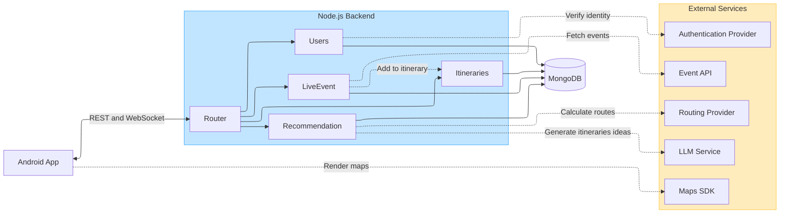
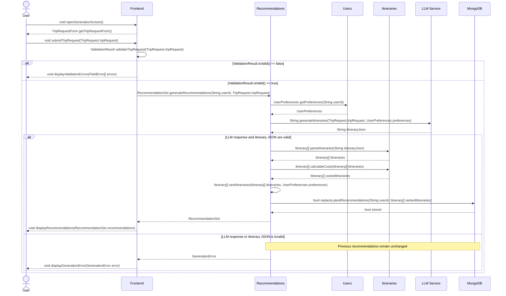
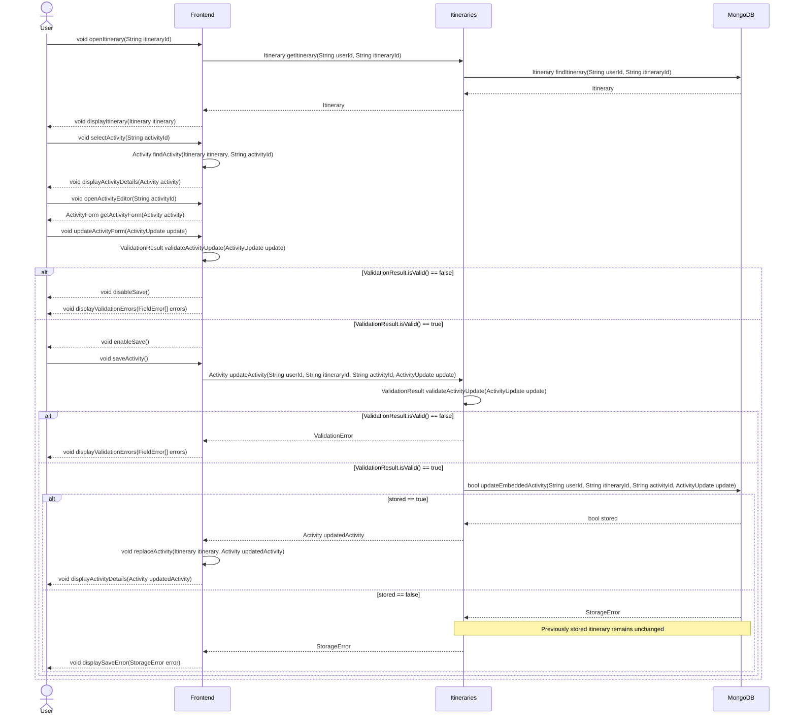
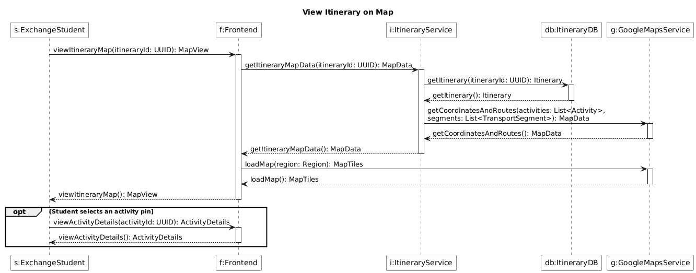

# Requirements and Design

## 1. Change History


| **Change Date**  | **Modified Sections** | **Rationale**                                                                                                                                                        |
| ---------------- | --------------------- | -------------------------------------------------------------------------------------------------------------------------------------------------------------------- |
| October 1, 2026  | 3.3, 3.4, 3.5         | Added actors, use case descriptions, and formal use case specifications for Feature Sets 2 and 3.                                                                    |
| October 14, 2026 | 4.1, 4.3, 4.4         | Added main components and interfaces from the View Itinerary on Map and Browse Popular Locations sequence diagrams, plus the Google Maps API and project frameworks. |


---

## 2. Project Description

Our project is called Explore UBC - a travel itinerary planner for UBC exchange students who want to explore British Columbia. It is an Android application built with Kotlin and JetPack Compose for the front-end, Node.js for the backend, MongoDB for the database and uses Vercel for deployment.

Planning a trip often means finding ideas, checking routes, and building a schedule. Travellers can sign up to create a profile with their interests, budget preference, and preferred transportation mode. They can also update their profile at any time. Our application uses Google Credential manager for authentication and session management.

The central use case is creating an itinerary. Travellers can add activities and transportation to their itinerary. At any time, they can also edit, remove and reorder these activities and transportation segments when those plans change. They can also request AI itinerary recommendations based on their profile. External LLMs provide the ideas, but our backend owns the final recommendation logic. This is the technical highlight of our project.

After adding activities, travellers can view activity locations on a map and see routes between them. The map also features pins for popular destinations nearby. Google Maps SDK supports these features. The app also includes a transportation cost calculator, helping travellers consider their budget. The calculator takes in vehicle type, fuel efficiency, fuel price, and distance to calculate the total cost.

Finally, travellers can view live event recommendations. Local events are retrieved from an external event service API and are matched to the user’s location and profile preferences. WebSockets allow new or modified live event updates to appear without refreshing. 

The features in this app will facilitate the entire trip planning process for UBC Exchange students, from choosing where to go and to getting there, leaving little room for unwanted surprises and making the journey a breeze.

---

## 3. Requirements Specification

### **3.1. List of Features**

### **3.2. Use Case Diagram**

### **3.3. Actors Description**

1. **Exchange Student**: The primary user of ExploreUBC. An incoming or current UBC exchange student who plans trips around campus and Vancouver, maintains a travel profile, creates itineraries, views maps, estimates transportation costs, and receives live event recommendations.
2. **Google Maps Service**: An external mapping service that supplies map tiles, geocoded activity coordinates, transportation routes between itinerary stops, and popular nearby locations.
3. **Event Information Service**: An external or backend-fed source of upcoming local events (for example concerts, shows, and campus events) used to generate in-app live recommendations.

### **3.4. Use Case Description**

#### Use Cases for Feature 1: Itinerary Recommendation

1. **Generate Itineraries**: The user can generate four ranked itinerary recommendations based on trip constraints and profile preferences.
2. **Review Recommendations**: The user reviews the latest generated itineraries and compares their activities, schedules, transportation segments, and rankings.
3. **Save a Recommendation**: The user selects a generated recommendation to save.

#### Use Cases for Feature 2: Itinerary Management

1. **Create an Itinerary**: The user creates a blank saved itinerary and provides its basic details.
2. **Modify Itinerary Details**: The user changes an itinerary's name or description.
3. **Add Activities or Transportation Segments**: The user adds an activity or transportation segment to a saved itinerary.
4. **Remove Activities or Transportation Segments**: The user removes an activity or transportation segment from a saved itinerary.
5. **Reorder Activities or Transportation Segments**: The user changes the order of activities and their associated transportation segments.
6. **Edit Activities or Transportation Segments**: The user changes details such as an activity's name, description, location, or time, or a transportation segment's mode and timing.
7. **Delete an Itinerary**: The user permanently removes a saved itinerary.
8. **View an Itinerary on the Map**: The user views the itinerary's activity locations and transportation routes on a map.

#### Use Cases for Feature 3: User Profile

1. **Update Preferences**: The user selects preferred transportation modes for future itinerary recommendations. The user sets or changes the default budget used for future recommendations. The user selects interests, such as food, art, or outdoor activities, that the system uses to personalize future itinerary and live-event recommendations.

#### Use Cases for Feature 4: Authentication

1. **Sign In with Google**: The user authenticates with Google, and the backend validates the Google identity before granting access to the associated ExploreUBC account.
2. **Sign Up with Google**: A first-time user authenticates with Google, after which the system creates an ExploreUBC account linked to the validated Google identity.
3. **Sign Out**: The user ends the current ExploreUBC session and returns to the authentication screen.

#### Use Cases for Feature 5: Google Maps

1. **View Itinerary on Map**: The exchange student selects a saved itinerary and the system plots its activity locations and connecting transportation routes on an interactive Google Map.
2. **Browse Popular Locations**: The exchange student opens the map and the system displays pins for popular locations in the current map region so the student can inspect them and consider adding them to a trip.

### **3.5. Formal Use Case Specifications (5 Most Major Use Cases)**

#### Use Case 1: Generate Itineraries

**Description**: The user can generate four ranked itinerary recommendations based on trip constraints and profile preferences.

**Primary actor(s)**: User
    
**Main success scenario**:
1. The user opens the itinerary-generation screen.
2. The user enters a starting location, available time, budget, transportation mode, and any request-specific interests or constraints.
3. The user selects **Generate Itineraries**.
4. The system generates and ranks four feasible candidate itineraries.
5. The system displays the four recommendations with their activities, transportation segments and rankings.

**Failure scenario(s)**:
- 3a. One or more required trip inputs are missing or invalid.
    - 3a1. The system identifies the invalid fields.
    - 3a2. The user corrects the inputs and submits the request again.
- 4a. An external generation or place-resolution service is unavailable or returns invalid data.
    - 4a1. The system does not replace the user's previous recommendation set.
    - 4b2. The system informs the user that recommendations could not be generated and allows another attempt.
- 4b. Fewer than four feasible itineraries satisfy the user's constraints.
    - 4b1. The system displays the feasible itineraries that were found.
    - 4b2. The system suggests relaxing the time, transportation, or interest constraints.

#### Use Case 2: Edit an Activity

**Description**: The user changes an activity's name, description, location, or duration.

**Primary actor(s)**: User

**Main success scenario**:
1. The user opens a saved itinerary.
2. The user selects an activity.
3. The system displays the activity's details.
4. The user selects `Edit`.
5. The user edits the activity's name, duration, location, or description.
6. The user selects `Save`.
7. The system saves and displays the updated activity.

**Failure scenario(s)**:
- 5a. The user enters an invalid start or end time.
    - 5a1. The system disables **Save**.
    - 5a2. The system displays an error message.
- 6a. The activity update cannot be stored because of a server or network error.
    - 6a1. The system leaves the previously saved activity unchanged.
    - 6a2. The system informs the user that the update failed and allows another attempt.

#### Use Case 3: View Itinerary on Map

**Description**: The exchange student visualizes a selected trip itinerary on Google Maps, including activity pins and transportation routes between consecutive activities.

**Primary actor(s)**: Exchange Student

**Main success scenario**:

1. The exchange student opens ExploreUBC and navigates to their saved itineraries.
2. The exchange student selects the itinerary they want to visualize.
3. The exchange student opens the map view for that itinerary.
4. The system loads the itinerary's scheduled activities (type, name, start/end time, location) and transportation segments (type, start/end time, pick-up/drop-off location, distance).
5. The system requests geocoded coordinates, map tiles, and route polylines from the Google Maps Service.
6. The Google Maps Service returns valid coordinates, map data, and routes for the itinerary.
7. The system displays the map with activity pins in chronological order and drawn routes between consecutive activities.
8. The exchange student pans, zooms, and taps pins to inspect activity and route details.

**Failure scenario(s)**:

- 1a. The exchange student is not authenticated.
  - 1a1. The system prompts the student to sign in.
  - 1a2. After successful authentication, the use case resumes at step 1. Otherwise, the use case ends.
- 2a. The student has no saved itineraries.
  - 2a1. The system shows an empty-state message explaining that an itinerary must be created first.
  - 2a2. The use case ends.
- 2b. The selected itinerary contains no activities.
  - 2b1. The system informs the student that the itinerary has nothing to plot.
  - 2b2. The use case ends.
- 4a. The system cannot load itinerary data because of a network or database error.
  - 4a1. The system displays an error and offers a retry action.
  - 4a2. If retry succeeds, the use case resumes at step 4. Otherwise, the use case ends.
- 5a. One or more activities have a missing or invalid location.
  - 5a1. The system plots the activities that can be geocoded and marks the invalid stops as unmapped.
  - 5a2. The system warns the student that some activities could not be shown on the map.
  - 5a3. The use case continues with the remaining mapped activities.
- 6a. The Google Maps Service is unavailable or returns an error.
  - 6a1. The system displays a map-unavailable message and offers the existing list view of the itinerary.
  - 6a2. The use case ends.
- 6b. A route cannot be computed between two consecutive activities.
  - 6b1. The system still shows both activity pins and omits only the failed route segment.
  - 6b2. The system notifies the student that this transportation leg could not be drawn.
  - 6b3. The use case continues with the remaining routes.


<a name="uc3"></a>

### **3.6. Screen Mock-ups**

### **3.7. Non-Functional Requirements**

1. **[WRITE_NAME_HERE]**
  - **Description**: ...
    - **Justification**: ...
2. ...

---

## 4. Designs Specification
### **4.1. Main Components**
1. **Itineraries**
    - **Purpose**: Manages saved itineraries and their activities.
    - **Interfaces**:
        1. `Itinerary createItinerary(String userId, ItineraryDetails details)`
            - **Purpose [3.4.2.1]**: Creates a saved itinerary for a user.
        2. `Itinerary insertItinerary(String userId, ItineraryDetails details)`
            - **Purpose [3.4.2.1]**: Stores a new itinerary in MongoDB.
        3. `Itinerary getItinerary(String userId, String itineraryId)`
            - **Purpose [3.4.2.2, 3.4.2.8]**: Retrieves a user's saved itinerary.
        4. `Itinerary findItinerary(String userId, String itineraryId)`
            - **Purpose [3.4.2.2, 3.4.2.8]**: Retrieves an itinerary document from MongoDB.
        5. `Itinerary updateItineraryDetails(String userId, String itineraryId, ItineraryDetails details)`
            - **Purpose [3.4.2.2]**: Updates the details of a saved itinerary.
        6. `bool updateItineraryDetails(String userId, String itineraryId, ItineraryDetails details)`
            - **Purpose [3.4.2.2]**: Stores updated itinerary details in MongoDB.
        7. `Activity addActivity(String userId, String itineraryId, ActivityInput activity)`
            - **Purpose [3.4.2.3]**: Adds an activity to a saved itinerary.
        8. `bool insertEmbeddedActivity(String userId, String itineraryId, Activity activity)`
            - **Purpose [3.4.2.3]**: Stores an activity in an itinerary document in MongoDB.
        9. `TransportationSegment addTransportationSegment(String userId, String itineraryId, TransportationSegmentInput segment)`
            - **Purpose [3.4.2.3]**: Adds a transportation segment to a saved itinerary.
        10. `bool insertEmbeddedTransportationSegment(String userId, String itineraryId, TransportationSegment segment)`
            - **Purpose [3.4.2.3]**: Stores a transportation segment in an itinerary document in MongoDB.
        11. `bool removeActivity(String userId, String itineraryId, String activityId)`
            - **Purpose [3.4.2.4]**: Removes an activity from a saved itinerary.
        12. `bool removeEmbeddedActivity(String userId, String itineraryId, String activityId)`
            - **Purpose [3.4.2.4]**: Removes an activity from an itinerary document in MongoDB.
        13. `bool removeTransportationSegment(String userId, String itineraryId, String segmentId)`
            - **Purpose [3.4.2.4]**: Removes a transportation segment from a saved itinerary.
        14. `bool removeEmbeddedTransportationSegment(String userId, String itineraryId, String segmentId)`
            - **Purpose [3.4.2.4]**: Removes a transportation segment from an itinerary document in MongoDB.
        15. `Itinerary reorderActivities(String userId, String itineraryId, String[] orderedActivityIds)`
            - **Purpose [3.4.2.5]**: Reorders activities and their associated transportation segments.
        16. `bool updateItineraryOrder(String userId, String itineraryId, String[] orderedActivityIds, TransportationSegment[] segments)`
            - **Purpose [3.4.2.5]**: Stores an updated itinerary order in MongoDB.
        17. `Activity updateActivity(String userId, String itineraryId, String activityId, ActivityUpdate update)`
            - **Purpose [3.4.2.6]**: Updates an activity in a saved itinerary.
        18. `bool updateEmbeddedActivity(String userId, String itineraryId, String activityId, ActivityUpdate update)`
            - **Purpose [3.4.2.6]**: Stores an updated activity in MongoDB.
        19. `TransportationSegment updateTransportationSegment(String userId, String itineraryId, String segmentId, TransportationSegmentUpdate update)`
            - **Purpose [3.4.2.6]**: Updates a transportation segment in a saved itinerary.
        20. `bool updateEmbeddedTransportationSegment(String userId, String itineraryId, String segmentId, TransportationSegmentUpdate update)`
            - **Purpose [3.4.2.6]**: Stores an updated transportation segment in MongoDB.
        21. `bool deleteItinerary(String userId, String itineraryId)`
            - **Purpose [3.4.2.7]**: Deletes a user's saved itinerary.
        22. `bool removeItinerary(String userId, String itineraryId)`
            - **Purpose [3.4.2.7]**: Removes an itinerary document from MongoDB.
2. **Users**
     - **Purpose**: It represents ExploreUBC accounts and persistent traveler preferences. It supports CRUD operations on the account. It provides profile data to the `Recommendation` and `LiveEvents` components. It exchanges a verified external identity for an ExploreUBC session.
    - **Interfaces**:
        1. `UserPreferences getPreferences(String userId)`
            - **Purpose**: Retrieves a user's saved preferences.
        2. `UserPreferences findPreferences(String userId)`
            - **Purpose**: Retrieves a user's preferences from MongoDB.
        3. `UserPreferences updatePreferences(String userId, PreferencesUpdate update)`
            - **Purpose**: Updates a user's profile preferences.
        4. `bool updatePreferences(String userId, PreferencesUpdate update)`
            - **Purpose**: Stores updated preferences in MongoDB.
3. **LiveEvents**
     - **Purpose**: ...
    - **Interfaces**: 
        1. ...
            - **Purpose**: ...
        2. ...
4. **Recommendations**
     - **Purpose**: It owns itinerary generation, rank calculation, and the create and read of latest recommendation set. It's responsible for requesting the LLM for itineraries, persisting the latest recommendation set.
    - **Interfaces**:
        1. `RecommendationSet findLatestRecommendations(String userId)`
            - **Purpose [3.4.1.2]**: Retrieves a user's latest recommendation set from MongoDB.
        2. `RecommendationSet generateRecommendations(String userId, TripRequest tripRequest)`
            - **Purpose [3.4.1.1]**: Generates itinerary recommendations for a user.
        3. `String generateItineraries(TripRequest tripRequest, UserPreferences preferences)`
            - **Purpose [3.4.1.1]**: Requests generated itinerary JSON from the LLM Service.
        4. `Itinerary[] parseItineraries(String itineraryJson)`
            - **Purpose [3.4.1.1]**: Converts generated itinerary JSON into itinerary objects.
        5. `bool replaceLatestRecommendations(String userId, Itinerary[] rankedItineraries)`
            - **Purpose [3.4.1.1]**: Stores a user's latest recommendation set in MongoDB.
5. **Maps:**
    - **Purpose**: The Android client that the exchange student uses. It renders the map view, plots itinerary and popular-location pins, and forwards map and place requests to the backend services and Google Maps. It also loads a saved itinerary and assembles the map data (activity coordinates and transportation routes) needed to plot that itinerary. It also finds popular places in a map region and loads details when the student selects a popular-location pin.
    - **Interfaces**:
        1. `viewItineraryMap(itineraryId: UUID): MapView`
            - **Purpose**: Opens the map for a selected itinerary and returns the map view with activity pins and routes.
        2. `viewActivityDetails(activityId: UUID): ActivityDetails`
            - **Purpose**: Shows the details of an itinerary activity when the student taps an activity pin.
        3. `browsePopularLocations(): MapView`
            - **Purpose**: Opens the map in the current region and returns the map view with popular-location pins.
        4. `viewPlaceDetails(placeId: String): PlaceDetails`
            - **Purpose**: Shows the name, category, and address of a popular location when the student taps a location pin.
        5. `loadMap(region: Region): MapTiles`
            - **Purpose**: Requests map tiles for the chosen region from the Google Maps Service (used by both View Itinerary on Map and Browse Popular Locations).
        6. `getItineraryMapData(itineraryId: UUID): MapData`
            - **Purpose**: Returns the map data for the selected itinerary, including geocoded activities and route polylines.
        7. `getItinerary(itineraryId: UUID): Itinerary`
            - **Purpose**: Reads the itinerary record (activities and transport segments) from the Itinerary DB.
        8. `getCoordinatesAndRoutes(activities: List<Activity>, segments: List<TransportSegment>): MapData`
            - **Purpose**: Asks the Google Maps Service to geocode activity locations and compute routes between consecutive stops.
        9. `getPopularLocations(region: Region): List<Place>`
            - **Purpose**: Returns popular places for the given region so the Frontend can show them as pins.
        10. `searchPopularPlaces(region: Region): List<Place>`
            - **Purpose**: Queries the Google Maps Service for popular places in the region.
        11. `getPlaceDetails(placeId: String): PlaceDetails`
            - **Purpose**: Returns the details of a selected place, fetching them from the Google Maps Service when needed.

### **4.2. Databases**

1. **Users**
    - **Purpose**: Represents an application user in ExploreUBC
    ```javascript
        "googleSubject",
        "email",
        "displayName",
        "start_location",
        "preferences":{
            "transportation":{
                "mode": "'walking' | 'cycling' | 'transit' | 'driving' | 'other'"
            }
        "budget": "'economical' | 'balanced' | 'premium'",
        "interest": "'food' | 'art' | 'outdoors' | 'markets' | 'live_music' | 'gaming'",
        "create_at",
        "updated_at"
      },
    ```
2. **Itineraries**
    - **Purpose**: Represents a saved itinerary
    ```javascript
        type Itinerary = {
            id: string;
            ownerId: string;
            name: string;
            description?: string;
            startingLocation?: string;
            items: ItineraryItem[]:{
                type ActivityItem = {
                    id: string;
                    name: string;
                    image: string;
                    description?: string;
                    category?: string;
                    location: string;
                    startTime: string;
                    endTime: string;
                    };

                    type TransportationItem = {
                    id: string;
                    mode: 'walking' | 'cycling' | 'transit' | 'driving' | 'other';
                    startLocation: string;
                    endLocation: string;
                    distance_m: number;
                    startTime: string;
                    endTime: string;
                    };
            };
            createdAt: string;
            updatedAt: string;
            saved: boolean;
            inRecommendation: boolean;
            score: {
                // fields that contribute to the score calculation
            }
        };
    ```

### **4.3. External Modules**

1. **Google Maps API**
  - **Purpose**: External mapping service used by ExploreUBC for the Feature Set 2 map view. The Android Maps SDK draws the interactive map, activity pins, popular-location pins, and routes. The same API key also supports Directions (walking routes between itinerary stops), Places Nearby Search (popular locations), and Static Maps (fallback image if live tiles do not load).

### **4.4. Frameworks and Libraries**

1. **Kotlin / Android SDK**
  - **Purpose**: Language and platform for the ExploreUBC mobile client, including activities, layouts, and location permissions.
    - **Reason**: The course requires an Android application, and Kotlin is the standard language for the Android toolchain used in this project.
2. **Jetpack Compose and Material 3**
  - **Purpose**: Declarative UI toolkit used for Compose-based screens such as the health-check activity.
    - **Reason**: Compose is the current Android UI stack in the project template and works with the pinned AndroidX Compose BOM.
3. **Google Play services Maps SDK**
  - **Purpose**: Client library that embeds Google Maps in the app and exposes `MapView` / `GoogleMap` for pins, polylines, and camera control.
    - **Reason**: Feature Set 2 requires an in-app map rather than only opening the external Google Maps app.
4. **Node.js, TypeScript, and Express**
  - **Purpose**: Runtime, language, and HTTP framework for the backend API (for example the health endpoint and future itinerary/location services).
    - **Reason**: The course backend template uses Express on Node 22 with TypeScript, which matches the Itinerary Service and Location Service in the sequence diagrams.
5. **Gradle / Android Gradle Plugin**
  - **Purpose**: Builds the Android app and injects configuration such as `API_BASE_URL` and `MAPS_API_KEY` from `local.properties`.
    - **Reason**: It is the required Android build system and keeps secrets out of source control.
6. **Jest**
  - **Purpose**: Test runner for backend interface and non-functional tests.
    - **Reason**: It is the backend testing framework specified by the course template.

### **4.5. Dependencies Diagram**


### **4.6. Use Case Sequence Diagram (5 Most Major Use Cases)**
#### 4.6.1. [**Generate Itineraries**](#use-case-1-generate-itineraries)



#### 4.6.2. [**Edit Activities**](#use-case-2-edit-an-activity)



#### 4.6.3. [**View itinerary on map**](#use-case-3-view-itinerary-on-map)
  

### **4.7. Design of Non-Functional Requirements**

1. **[[WRITE_NAME_HERE]](#nfr1)**
  - **Implementation**: ...
2. ...

