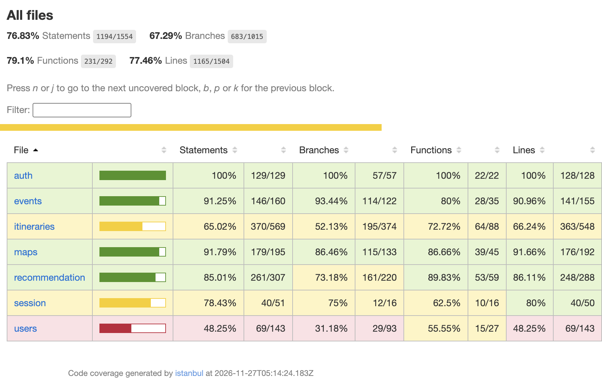
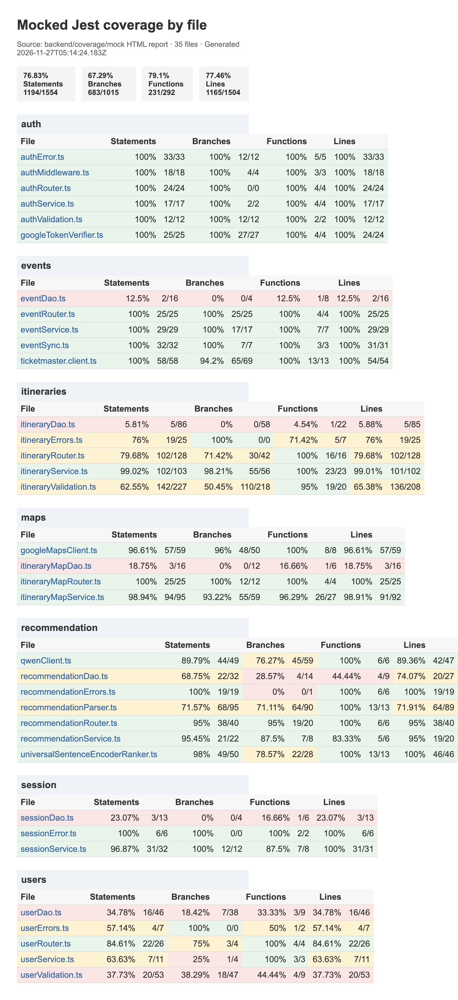
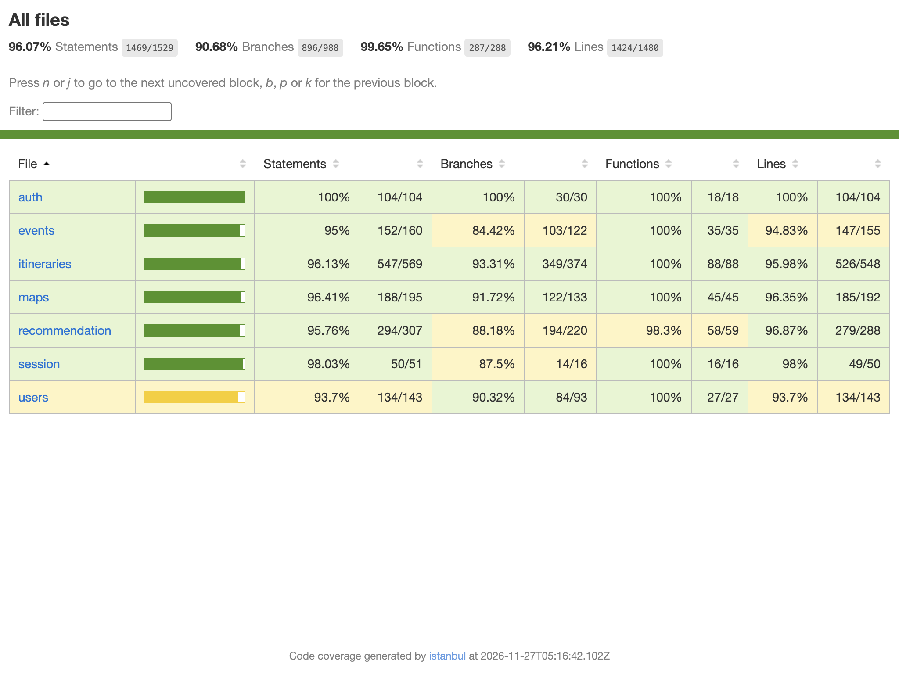
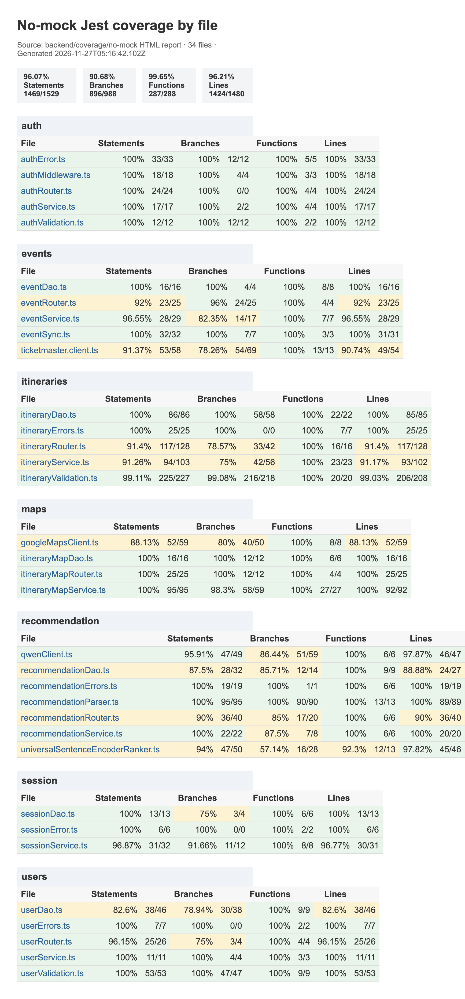
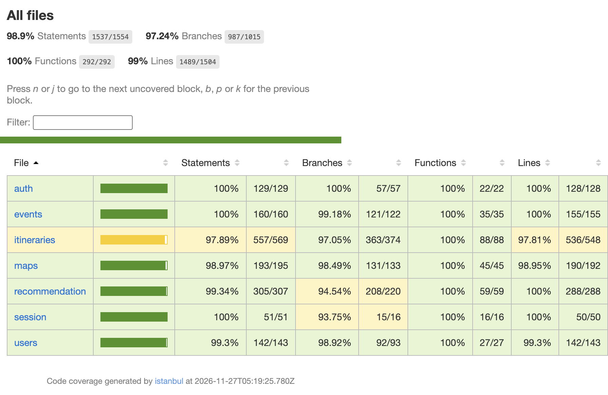
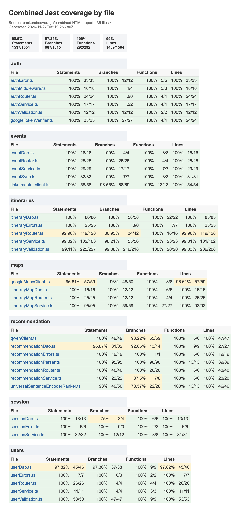

# Testing

## 1. Change History

| **Change Date**   | **Modified Sections** | **Rationale** |
| ----------------- | --------------------- | ------------- |
| November 26, 2026 | 4.2–4.3 | Linked scenario steps to individual generated E2E test results. |
| November 26, 2026 | 4.3 | Ran all frontend E2E classes and recorded the runner output and generated result for every test. |
| November 26, 2026 | 2.1.2, 2.3–2.5 | Reran all three backend suites on the current backend commit and captured matching folder-level and file-level coverage screenshots from each fresh report. |
| November 20, 2026 | 2.1.2, 2.3–2.5 | Reran the backend test suites and refreshed the commit, results, coverage figures, and HTML report screenshots. |
| November 20, 2026 | 2.1, 3.1, 3.2, 4.1   | Separated functional Authentication coverage from the Security NFR, documented session and ownership coverage, and clarified that Authentication is outside the selected frontend feature-E2E scope. |
| November 20, 2026 | 2.1, 4.2              | Named the mocked Security dependencies and verified that every frontend use-case scenario references its Section 3.4 use-case number. |
| November 19, 2026 | 2.1, 4.1, 4.2         | Named the actual mocked dependencies, aligned frontend scenario labels with Section 3.4, and converted frontend E2E suites to the real authenticated app and backend. |
| November 19, 2026 | 3.1, 3.2, 4.1, 4.2 | Removed frontend login/logout E2E coverage and limited frontend security E2E testing to missing-session and cross-user authorization. |
| November 18, 2026 | 4.2                   | Added end-to-end specifications for viewing an itinerary on the map and browsing popular locations. |
| November 18, 2026 | 2.1, 2.3–2.6         | Added mock and no-mock coverage for the itinerary map GET API and Google Maps integration. |
| November 17, 2026 | 3.1, 3.2              | Added frontend and backend NFR coverage for secure authentication and session management. |
| October 28, 2026  | 3.1, 3.2              | Added automated and manual verification details and results for the Accessibility NFR. |
| November 6, 2026  | 2.1.1, 2.1.3, 2.3, 2.4, 2.5, 2.6 | Added the planned Live Events backend API test locations, run instructions, and coverage placeholders. |
| November 6, 2026  | 4.1, 4.2              | Added the planned Live Events frontend E2E scenarios: View Event Recommendations, Add an Event to an Itinerary, and Refresh After a Preference Change. |
| November 18, 2026 | 2.6, 4.1, 4.2         | Implemented the Live Events tests: removed the planned markers, added the Ticketmaster coverage note, the real-backend setup, the component tests, and the Refresh After a Location Change scenario. |

---

## 2. Back-end Test Specification: APIs

### 2.1. Locations of Back-end Tests and Instructions to Run Them

#### 2.1.1. Tests

| **Interface** | **Describe Group Location, No Mocks** | **Describe Group Location, With Mocks** | **Mocked Components** |
| --- | --- | --- | --- |
| **GET /api/v1/users/:userId** | [`backend/tests/no-mock/users/users.test.ts`](../backend/tests/no-mock/users/users.test.ts) | [`backend/tests/mock/users/users.test.ts`](../backend/tests/mock/users/users.test.ts) | `UserRepository`; `SessionService` path-validator test double |
| **PATCH /api/v1/users/:userId** | [`backend/tests/no-mock/users/users.test.ts`](../backend/tests/no-mock/users/users.test.ts) | [`backend/tests/mock/users/users.test.ts`](../backend/tests/mock/users/users.test.ts) | `UserRepository`; `SessionService` path-validator test double |
| **POST /api/v1/users/:userId/itineraries** | [`backend/tests/no-mock/itineraries/itineraries.test.ts`](../backend/tests/no-mock/itineraries/itineraries.test.ts) | [`backend/tests/mock/itineraries/itineraries.test.ts`](../backend/tests/mock/itineraries/itineraries.test.ts) | `ItineraryRepository`; `SessionService` path-validator test double |
| **GET /api/v1/users/:userId/itineraries** | [`backend/tests/no-mock/itineraries/itineraries.test.ts`](../backend/tests/no-mock/itineraries/itineraries.test.ts) | [`backend/tests/mock/itineraries/itineraries.test.ts`](../backend/tests/mock/itineraries/itineraries.test.ts) | `ItineraryRepository`; `SessionService` path-validator test double |
| **GET /api/v1/users/:userId/itineraries/:itineraryId/details** | [`backend/tests/no-mock/itineraries/itineraries.test.ts`](../backend/tests/no-mock/itineraries/itineraries.test.ts) | [`backend/tests/mock/itineraries/itineraries.test.ts`](../backend/tests/mock/itineraries/itineraries.test.ts) | `ItineraryRepository`; `SessionService` path-validator test double |
| **GET /api/v1/users/:userId/itineraries/:itineraryId** | [`backend/tests/no-mock/itineraries/itineraries.test.ts`](../backend/tests/no-mock/itineraries/itineraries.test.ts) | [`backend/tests/mock/itineraries/itineraries.test.ts`](../backend/tests/mock/itineraries/itineraries.test.ts) | `ItineraryRepository`; `SessionService` path-validator test double |
| **GET /api/v1/users/:userId/itineraries/:itineraryId/map** | [`backend/tests/no-mock/maps/itineraryMap.test.ts`](../backend/tests/no-mock/maps/itineraryMap.test.ts) | [`backend/tests/mock/maps/itineraryMap.test.ts`](../backend/tests/mock/maps/itineraryMap.test.ts) | `ItineraryRepository`; `ItineraryMapRepository`; `MapProvider` (Google Geocoding and Routes); `SessionService` path-validator test double |
| **PATCH /api/v1/users/:userId/itineraries/:itineraryId** | [`backend/tests/no-mock/itineraries/itineraries.test.ts`](../backend/tests/no-mock/itineraries/itineraries.test.ts) | [`backend/tests/mock/itineraries/itineraries.test.ts`](../backend/tests/mock/itineraries/itineraries.test.ts) | `ItineraryRepository`; `SessionService` path-validator test double |
| **DELETE /api/v1/users/:userId/itineraries/:itineraryId** | [`backend/tests/no-mock/itineraries/itineraries.test.ts`](../backend/tests/no-mock/itineraries/itineraries.test.ts) | [`backend/tests/mock/itineraries/itineraries.test.ts`](../backend/tests/mock/itineraries/itineraries.test.ts) | `ItineraryRepository`; `ItineraryMapRepository`; `SessionService` path-validator test double |
| **POST /api/v1/users/:userId/itineraries/:itineraryId/activities** | [`backend/tests/no-mock/itineraries/itineraries.test.ts`](../backend/tests/no-mock/itineraries/itineraries.test.ts) | [`backend/tests/mock/itineraries/itineraries.test.ts`](../backend/tests/mock/itineraries/itineraries.test.ts) | `ItineraryRepository`; `SessionService` path-validator test double |
| **PATCH /api/v1/users/:userId/itineraries/:itineraryId/activities/:activityId** | [`backend/tests/no-mock/itineraries/itineraries.test.ts`](../backend/tests/no-mock/itineraries/itineraries.test.ts) | [`backend/tests/mock/itineraries/itineraries.test.ts`](../backend/tests/mock/itineraries/itineraries.test.ts) | `ItineraryRepository`; `SessionService` path-validator test double |
| **DELETE /api/v1/users/:userId/itineraries/:itineraryId/activities/:activityId** | [`backend/tests/no-mock/itineraries/itineraries.test.ts`](../backend/tests/no-mock/itineraries/itineraries.test.ts) | [`backend/tests/mock/itineraries/itineraries.test.ts`](../backend/tests/mock/itineraries/itineraries.test.ts) | `ItineraryRepository`; `SessionService` path-validator test double |
| **POST /api/v1/users/:userId/itineraries/:itineraryId/transportation-segments** | [`backend/tests/no-mock/itineraries/itineraries.test.ts`](../backend/tests/no-mock/itineraries/itineraries.test.ts) | [`backend/tests/mock/itineraries/itineraries.test.ts`](../backend/tests/mock/itineraries/itineraries.test.ts) | `ItineraryRepository`; `SessionService` path-validator test double |
| **PATCH /api/v1/users/:userId/itineraries/:itineraryId/transportation-segments/:segmentId** | [`backend/tests/no-mock/itineraries/itineraries.test.ts`](../backend/tests/no-mock/itineraries/itineraries.test.ts) | [`backend/tests/mock/itineraries/itineraries.test.ts`](../backend/tests/mock/itineraries/itineraries.test.ts) | `ItineraryRepository`; `SessionService` path-validator test double |
| **DELETE /api/v1/users/:userId/itineraries/:itineraryId/transportation-segments/:segmentId** | [`backend/tests/no-mock/itineraries/itineraries.test.ts`](../backend/tests/no-mock/itineraries/itineraries.test.ts) | [`backend/tests/mock/itineraries/itineraries.test.ts`](../backend/tests/mock/itineraries/itineraries.test.ts) | `ItineraryRepository`; `SessionService` path-validator test double |
| **GET /api/v1/users/:userId/recommendations** | [`backend/tests/no-mock/recommendation/recommendation.test.ts`](../backend/tests/no-mock/recommendation/recommendation.test.ts) | [`backend/tests/mock/recommendation/recommendation.test.ts`](../backend/tests/mock/recommendation/recommendation.test.ts) | `RecommendationRepository`; `SessionService` path-validator test double |
| **POST /api/v1/users/:userId/recommendations** | [`backend/tests/no-mock/recommendation/recommendation.test.ts`](../backend/tests/no-mock/recommendation/recommendation.test.ts) | [`backend/tests/mock/recommendation/recommendation.test.ts`](../backend/tests/mock/recommendation/recommendation.test.ts) | `ItineraryGenerator` (Qwen provider); `ItineraryRanker`; `RecommendationRepository`; `UserRepository`; `SessionService` path-validator test double |
| **POST /api/v1/auth/google** | [`backend/tests/no-mock/auth/auth.test.ts`](../backend/tests/no-mock/auth/auth.test.ts) | [`backend/tests/mock/auth/auth.test.ts`](../backend/tests/mock/auth/auth.test.ts) | `GoogleTokenVerifier`; `GoogleVerificationClient`; `gaxios.request`; `UserRepository`; `SessionRepository` |
| **GET /api/v1/auth/session** | [`backend/tests/nfr/no-mock/session/session.test.ts`](../backend/tests/nfr/no-mock/session/session.test.ts) | [`backend/tests/nfr/mock/session/session.test.ts`](../backend/tests/nfr/mock/session/session.test.ts) | `UserRepository`; `SessionRepository`; injected clock and random-byte source; `SessionService` middleware test double |
| **DELETE /api/v1/auth/session** | [`backend/tests/no-mock/auth/auth.test.ts`](../backend/tests/no-mock/auth/auth.test.ts) | [`backend/tests/mock/auth/auth.test.ts`](../backend/tests/mock/auth/auth.test.ts) | `GoogleTokenVerifier`; `UserRepository`; `SessionRepository` |
| **GET /api/v1/users/:userId/events** | [`backend/tests/no-mock/events/events.test.ts`](../backend/tests/no-mock/events/events.test.ts) | [`backend/tests/mock/events/events.test.ts`](../backend/tests/mock/events/events.test.ts) | `UserRepository`; `EventRepository`; `SessionService` path-validator test double |

#### 2.1.2. Commit Hash Where Tests Run

`934a48e1316311b22c26edb0b47fec390cc2fe1b`

All three runs used the backend source and tests at this commit. The documentation and screenshot updates are uncommitted working-tree changes.

#### 2.1.3. Explanation on How to Run the Tests

1. Add a reachable `MONGODB_URI`, `GEOCODING_API_KEY`, `ROUTES_API_KEY`, `QWEN_ENDPOINT`, `QWEN_API_KEY`, and `QWEN_MODEL` to `backend/.env`. The no-mock suites create uniquely named temporary databases and drop them after the run.
2. From `backend`, install dependencies with `npm install`.
3. Run the user, itinerary, recommendation, Live Events, and no-mock authentication/session suites with coverage. The live recommendation POST uses the configured provider and retries one transient generation failure. Its timeout allows two provider requests at the configured timeout, plus one minute for ranking and persistence:
   ```sh
   npm run test:no-mock
   ```
4. Run the mocked feature-failure, authentication/session, and Live Events suites with coverage:
   ```sh
   npm run test:mock
   ```
5. Run both sets together with coverage:
   ```sh
   npm run test:combined
   ```


### 2.2. GitHub Actions Configuration Location

`.github/workflows/backend-tests.yml`

### 2.3. Jest Coverage Report Screenshots With Mocks

Run `npm run test:mock` to generate the HTML report under `backend/coverage/mock`.


The file-level tables from the same report are shown below, grouped by source folder.


The `npm run test:mock` run passed all 13 suites and all 225 tests in 2.087 seconds. It covers 76.83% of statements, 67.29% of branches, 79.10% of functions, and 77.46% of lines. The map router has 100% coverage in this run. Lower standalone mock coverage is expected because these tests focus on provider failures, database exceptions, vector edge cases, and concurrency-related error handling rather than normal API behavior.

### 2.4. Jest Coverage Report Screenshots Without Mocks


Run `npm run test:no-mock` to generate the HTML report under `backend/coverage/no-mock`.


The file-level tables from the same report are shown below, grouped by source folder.


The `npm run test:no-mock` run passed all 10 suites and all 291 tests in 126.319 seconds. It covers 96.07% of statements, 90.68% of branches, 99.65% of functions, and 96.21% of lines. The enforced no-mock thresholds are 95% of statements, 89% of branches, 99% of functions, and 95% of lines. The map suite exercises the real Express router, services, MongoDB DAOs, session ownership middleware, Google Geocoding API, and Google Routes API. External-provider clients use real HTTP against deterministic local provider servers where practical, while MongoDB and application components remain unmocked.

### 2.5. Jest Coverage Report Screenshots (Mock + No-Mocks)


Run `npm run test:combined` to generate the HTML report under `backend/coverage/combined`.


The file-level tables from the same report are shown below, grouped by source folder.


The `npm run test:combined` run passed all 23 suites and all 516 tests in 144.098 seconds. It covers 98.90% of statements, 97.24% of branches, 100% of functions, and 99.00% of lines. The maps feature reaches 98.97% of statements, 98.49% of branches, 100% of functions, and 98.95% of lines. This exceeds the combined global thresholds of 98% statements, 96% branches, 99% functions, and 98% lines.

### 2.6. Coverage Justifications

The no-mock run is intentionally below 100% because database/network failure branches require controlled mocks, empty Express path parameters cannot be produced through normal HTTP routing, and race conditions in which a document is removed between a service read and write cannot be triggered deterministically without mocking. Both the no-mock and combined configurations retain their coverage gates.
The main remaining branches are unreachable empty Express route parameters. Recommendation interface tests run in both suites; the no-mock suite covers live generation, real persistence, parsing, configuration, profile validation, and ranking, while the mock suite covers provider failures and database publication races. `*Types.ts` and `*Repository.ts` files contain only TypeScript types and interfaces that are erased at runtime, so both focused coverage configurations exclude them.
The no-mock configuration also excludes `googleTokenVerifier.ts` because CI cannot non-interactively obtain a valid user Google ID token. Its authentication tests control only that external verification boundary while exercising the real auth service, user DAO, session service, session DAO, and MongoDB. The mocked functional authentication suite separately covers verified claims, invalid claims, expiry, audience and issuer checks, and Google transport failures.

For Live Events, the code that connects to the database and starts a sync from the command line (`npm run sync:events`) lives in [`backend/scripts/sync-events.ts`](../backend/scripts/sync-events.ts), outside `src/`, so it is not part of the coverage. Event synchronization is not exposed through the API, and a scheduled job (GitHub Actions or an AWS cron job) will run that script instead of users. The mock suite covers controlled failure or unusual data: retrying after a 429 or a dropped connection, a missing API key, an invalid page number, and the fallbacks for optional event fields (no 16:9 image, `pleaseNote` instead of `info`, no price, an invalid end time, invalid coordinates).

The only uncovered area is:

- `src/events/ticketmaster.client.ts`: reaches 100% of statements, lines, and functions. One branch remains uncovered: the default value `page = 0` of the internal request function, which is never used because the client is always called with an explicit page number.
---

## 3. Tests of Non-Functional Requirements

### 3.1. Test Locations in Git

| **Non-Functional Requirement**  | **Location in Git**                              |
| ------------------------------- | ------------------------------------------------ |
| **Accessibility**               | [`frontend/app/src/androidTest/java/com/exploreUBC/cpen321application/nfr/AccessibilityTest.kt`](../frontend/app/src/androidTest/java/com/exploreUBC/cpen321application/nfr/AccessibilityTest.kt)<br>[`frontend/app/src/androidTest/java/com/exploreUBC/cpen321application/nfr/AccessibilityScreenScalingTest.kt`](../frontend/app/src/androidTest/java/com/exploreUBC/cpen321application/nfr/AccessibilityScreenScalingTest.kt) |
| **Security** | Frontend component test: [`SessionRestorationNfrTest.kt`](../frontend/app/src/androidTest/java/com/exploreUBC/cpen321application/nfr/SessionRestorationNfrTest.kt)<br>Frontend real-backend NFR integration test: [`AuthorizationNfrTest.kt`](../frontend/app/src/androidTest/java/com/exploreUBC/cpen321application/nfr/AuthorizationNfrTest.kt)<br>Backend with mocks: [`nfr/mock/session/session.test.ts`](../backend/tests/nfr/mock/session/session.test.ts)<br>Backend without mocks: [`nfr/no-mock/session/session.test.ts`](../backend/tests/nfr/no-mock/session/session.test.ts) |

### 3.2. Test Verification and Logs

#### Security

| **Scenario ID** | **Security Scenario** | **Expected Behavior** | **Automated Coverage** |
| --- | --- | --- | --- |
| **NFR-SEC-BE-1** | The backend restores and renews a valid session. | The backend returns the persisted user, rolls the session expiry forward, returns no replacement raw token, and keeps only the token hash in MongoDB. | Backend mock and no-mock session suites. |
| **NFR-SEC-BE-2** | A request presents a missing, malformed, unknown, expired, or revoked session. | The backend rejects the request with `401 Unauthorized`; an expired session and a session whose user no longer exists are removed from persistence. | Backend mock and no-mock session suites. |
| **NFR-SEC-FE-0** | The application starts with a stored session. | The frontend calls `GET /auth/session`, stores the renewed expiry while retaining the existing session token, and clears both persisted and in-memory session state when the backend returns `401 Unauthorized`. | `SessionRestorationNfrTest`. |
| **NFR-SEC-FE-1** | The frontend calls a protected endpoint without a session token. | The real backend rejects the request with `401 Unauthorized`, and no protected user data is returned. | `AuthorizationNfrTest.protectedRequestWithoutSessionIsRejectedByBackend`. |
| **NFR-SEC-FE-2** | A logged-in user requests another user's protected resource. | The real backend rejects the request with `403 Forbidden`, and the other user's resource is not returned. | `AuthorizationNfrTest.authenticatedUserCannotReadDatabaseInitUser`. |

- **Verification:** The backend NFR suites cover restoration, rolling renewal, missing and malformed credentials, expiry, revocation, hash-only persistence, missing users, and ownership middleware. `SessionRestorationNfrTest` verifies the frontend restore contract and fail-closed clearing with a controlled backend boundary. `AuthorizationNfrTest` is a separate real-backend NFR integration test: it sends one request without a token and one request using an authenticated session against another user's ID. Neither frontend NFR test exercises Google login or logout, and neither is part of the frontend feature-E2E package.

- **Frontend NFR success log:**

  ```text
  Running frontend NFR tests:
    AccessibilityScreenScalingTest
    AccessibilityTest
    AuthorizationNfrTest
    SessionRestorationNfrTest

  Starting 8 tests on Medium_Phone_API_36.0(AVD) - 16
  Finished 8 tests on Medium_Phone_API_36.0(AVD) - 16
  BUILD SUCCESSFUL in 19s
  Frontend NFR tests finished.
  ```

- **Accessibility: Visual Label and Content Description Consistency**

  - **Verification:** The test renders the primary navigation and reads each destination's visible text and icon `contentDescription` from the Compose semantics tree. It asserts that both values are equal for Events, Trips, Map, and Profile, and confirms that each label is present in the merged accessibility tree.
  - **Log Output:** This test was run as part of the combined automated accessibility test suite. The combined Gradle output is shown under **Accessibility: Automated Test Suite Execution**.

- **Accessibility: Minimum Navigation Target Size**

  - **Verification:** The test measures the rendered bounds of every primary navigation target, converts the measurements from pixels to density-independent pixels, and asserts that both the width and height are at least 48 dp.
  - **Log Output:** This test was run as part of the combined automated accessibility test suite. The combined Gradle output is shown under **Accessibility: Automated Test Suite Execution**.

- **Accessibility: Navigation Click Actions**

  - **Verification:** The test confirms that Events, Trips, Map, and Profile each expose a click action in the Compose semantics tree, ensuring that accessibility services recognize every primary navigation target as interactive.
  - **Log Output:** This test was run as part of the combined automated accessibility test suite. The combined Gradle output is shown under **Accessibility: Automated Test Suite Execution**.

- **Accessibility: Navigation at 200% Font Scale**

  - **Verification:** The test renders the application with a font scale of 2.0 and asserts that the Events, Trips, Map, and Profile labels remain displayed and expose click actions. This automated check verifies basic visibility and operability at 200% font scaling. A separate manual test verifies visual clipping and overlap.
  - **Log Output:** This test was run as part of the combined automated accessibility test suite. The combined Gradle output is shown under **Accessibility: Automated Test Suite Execution**.

- **Accessibility: Automated Test Suite Execution**

  - **Verification:** The accessibility tests are included automatically with the Security frontend NFR tests because the runner discovers every test class in the `nfr` package.

- **Accessibility: Manual TalkBack Verification**

  - **Verification:** TalkBack was enabled on the Pixel 9 API 36 emulator. Each primary navigation destination was focused and activated. TalkBack announced the same destination name shown in the interface, and each item remained operable.
  - **Log Output**
    ```
    Device: Pixel 9 emulator, API 36
    Events: Correct name announced and item activated successfully.
    Trips: Correct name announced and item activated successfully.
    Map: Correct name announced and item activated successfully.
    Profile: Correct name announced and item activated successfully.
    Overall result: PASS
    ```

- **Accessibility: Manual 200% Font-Scale Verification**

  - **Verification:** Android font scaling was set to 200% on the Pixel 9 API 36 emulator. The Events, Trips, Map, and Profile labels remained visible and operable. No navigation label was clipped, overlapped, or displayed with unusable wrapping.
  - **Log Output**
    ```
    Device: Pixel 9 emulator, API 36
    Events: Visible and operable with no clipping or overlap.
    Trips: Visible and operable with no clipping or overlap.
    Map: Visible and operable with no clipping or overlap.
    Profile: Visible and operable with no clipping or overlap.
    Overall result: PASS
    ```

---

## 4. Front-end Test Specification

### 4.1. Location in Git of Front-end Test Suite:

- Itinerary scenarios: [`frontend/app/src/androidTest/java/com/exploreUBC/cpen321application/e2e/itineraries/ItineraryE2ETest.kt`](../frontend/app/src/androidTest/java/com/exploreUBC/cpen321application/e2e/itineraries/ItineraryE2ETest.kt)
- Map scenarios: [`frontend/app/src/androidTest/java/com/exploreUBC/cpen321application/e2e/maps/MapE2ETest.kt`](../frontend/app/src/androidTest/java/com/exploreUBC/cpen321application/e2e/maps/MapE2ETest.kt)
- Recommendation scenarios:
  - Success: [`frontend/app/src/androidTest/java/com/exploreUBC/cpen321application/e2e/recommendation/RecommendationE2ETest.kt`](../frontend/app/src/androidTest/java/com/exploreUBC/cpen321application/e2e/recommendation/RecommendationE2ETest.kt)
  - Failure: [`frontend/app/src/androidTest/java/com/exploreUBC/cpen321application/e2e/recommendation/RecommendationFailureE2ETest.kt`](../frontend/app/src/androidTest/java/com/exploreUBC/cpen321application/e2e/recommendation/RecommendationFailureE2ETest.kt)
- User profile scenarios: [`frontend/app/src/androidTest/java/com/exploreUBC/cpen321application/e2e/users/UserProfileE2ETest.kt`](../frontend/app/src/androidTest/java/com/exploreUBC/cpen321application/e2e/users/UserProfileE2ETest.kt)
- First-login profile scenarios:
  - Success: [`frontend/app/src/androidTest/java/com/exploreUBC/cpen321application/e2e/users/CreateProfileE2ETest.kt`](../frontend/app/src/androidTest/java/com/exploreUBC/cpen321application/e2e/users/CreateProfileE2ETest.kt)
  - Failure: [`frontend/app/src/androidTest/java/com/exploreUBC/cpen321application/e2e/users/CreateProfileFailureE2ETest.kt`](../frontend/app/src/androidTest/java/com/exploreUBC/cpen321application/e2e/users/CreateProfileFailureE2ETest.kt)
- Live Events scenarios:
  - Recommendations, Load more, and preference changes: [`frontend/app/src/androidTest/java/com/exploreUBC/cpen321application/e2e/events/LiveEventsE2ETest.kt`](../frontend/app/src/androidTest/java/com/exploreUBC/cpen321application/e2e/events/LiveEventsE2ETest.kt)
  - Location change: [`frontend/app/src/androidTest/java/com/exploreUBC/cpen321application/e2e/events/LiveEventsLocationChangeE2ETest.kt`](../frontend/app/src/androidTest/java/com/exploreUBC/cpen321application/e2e/events/LiveEventsLocationChangeE2ETest.kt)
  - Add an event to an itinerary: [`frontend/app/src/androidTest/java/com/exploreUBC/cpen321application/e2e/events/EventItineraryE2ETest.kt`](../frontend/app/src/androidTest/java/com/exploreUBC/cpen321application/e2e/events/EventItineraryE2ETest.kt)
  - Empty state: [`frontend/app/src/androidTest/java/com/exploreUBC/cpen321application/e2e/events/LiveEventsEmptyStateE2ETest.kt`](../frontend/app/src/androidTest/java/com/exploreUBC/cpen321application/e2e/events/LiveEventsEmptyStateE2ETest.kt)
  - Setup check: [`frontend/app/src/androidTest/java/com/exploreUBC/cpen321application/e2e/events/LiveEventsSmokeE2ETest.kt`](../frontend/app/src/androidTest/java/com/exploreUBC/cpen321application/e2e/events/LiveEventsSmokeE2ETest.kt)
  - Screen component tests: [`frontend/app/src/androidTest/java/com/exploreUBC/cpen321application/ui/events/LiveEventsScreenTest.kt`](../frontend/app/src/androidTest/java/com/exploreUBC/cpen321application/ui/events/LiveEventsScreenTest.kt)
  - Recommendation refresh component tests: [`frontend/app/src/androidTest/java/com/exploreUBC/cpen321application/ui/events/EventRecommendationRefreshTest.kt`](../frontend/app/src/androidTest/java/com/exploreUBC/cpen321application/ui/events/EventRecommendationRefreshTest.kt)
  - API component tests: [`frontend/app/src/androidTest/java/com/exploreUBC/cpen321application/data/events/EventsApiTest.kt`](../frontend/app/src/androidTest/java/com/exploreUBC/cpen321application/data/events/EventsApiTest.kt)


### 4.2. Tests

<a id="e2e-steps-01"></a>

- **Use Case 3.4.3.1: Create Profile** (User)

  - **Log:** [firstLoginCreatesProfileWithLocationAndPreferences](#e2e-firstlogincreatesprofilewithlocationandpreferences), [incompleteProfileCanLogOut](#e2e-incompleteprofilecanlogout).
  - **Failure tests:** [`CreateProfileFailureE2ETest.kt`](../frontend/app/src/androidTest/java/com/exploreUBC/cpen321application/e2e/users/CreateProfileFailureE2ETest.kt)

  The logout control below is an alternate escape path from incomplete profile creation. It verifies that this screen returns to the login screen, but it is not complete frontend E2E coverage of Authentication use case 3.4.4.3.

  - **Expected Behaviors:**
    | **Scenario Steps** | **Test Case Steps** |
    | ------------------ | ------------------- |
    | 1. The user signs in for the first time. | Render the first-login profile flow and verify that the `Create profile` page is displayed. |
    | 2. The system shows the starting-location field and transportation, budget, and interest controls. | Check that the location field, all three preference dropdowns, and the `Create profile` button are displayed. |
    | 3. The user has not entered a starting location. | Check that the `Create profile` button is disabled. |
    | 4. The user enters `UBC Bus Exchange` and selects transit, balanced, and outdoors. | Enter the location and select each preference from its dropdown. |
    | 5. The user selects `Create profile`. | Check that the button is enabled, click it, and wait for completion. |
    | 6. The system saves the profile and finishes first-login setup. | Verify that onboarding is marked complete and that the repository contains the chosen location and preferences. |
    | 2a. The user does not want to finish creating the profile. | Check that the `Log out` button is displayed at the bottom of the page and select it. |
    | 2a1. The stored session is cleared. | Verify that the existing logout callback runs so the application returns to the login screen. |
    | 5a. The starting location is missing or exceeds the supported length. | Leave the location empty or enter a 501-character location. |
    | 5a1. The system disables `Create profile` and identifies the invalid field. | Check that `Create profile` is disabled.<br>For an overlong location, check that `Start location must be at most 500 characters.` is present. |
    | 6a. The profile cannot be saved because of a server or network error. | Select `Create profile` while the save request fails. |
    | 6a1. The system keeps the entered values and allows another attempt. | Check that the location and preferences remain selected, an error is shown, and `Create profile` is available again. |

<a id="e2e-steps-02"></a>

- **Use Case 3.4.3.2: Update Profile** (User)

  - **Log:** [updateDisplayNameAndStartingLocationAndValidateMaximumLength](#e2e-updatedisplaynameandstartinglocationandvalidatemaximumlength), [updateTransportationBudgetAndInterestPreferences](#e2e-updatetransportationbudgetandinterestpreferences).

  - **Expected Behaviors:**
    | **Scenario Steps** | **Test Case Steps** |
    | ------------------ | ------------------- |
    | 1. The user opens the user profile tab. | Open User Profile screen |
    | 2. The app shows the user's display name and starting location, plus transportation, budget, and interest preferences. | Check that the display name and starting location are present.<br>Check that the three preference dropdowns and their save control are present. |
    | 2a. The user enters profile details that exceed the supported length. | Click the `Edit` button.<br>Input a 201-character value in the `Display name` field and a valid value in the `Starting location` field. |
    | 2a1. The profile length error is displayed. | Check that the `Save profile` button is disabled.<br>Check that the red error message `Display name must be at most 200 characters.` is present. |
    | 3. The user edits the profile and enters a new starting location. | Click `Edit`, replace the starting location with `12345 abc Avenue, Vancouver BC`, and click `Save profile`. |
    | 4. The system saves the new starting location. | Check that the updated starting location is displayed and persisted in the user repository. |
    | 5. The user selects another transportation preference. | Open the transportation dropdown, verify walking, cycling, transit, driving, and other are available, then select transit. |
    | 6. The user selects another budget preference. | Open the budget dropdown, verify economical, balanced, and premium are available, then select balanced. |
    | 7. The user selects another interest preference. | Open the interest dropdown, verify food, art, outdoors, markets, live music, and gaming are available, then select outdoors. |
    | 8. The user saves the preference changes. | Click `Save preferences`, check that `Preferences saved.` appears, and verify that the selected preferences are persisted. |

<a id="e2e-steps-03"></a>

- **Use Case 3.4.2.1: Create an Itinerary** (Itineraries)

  - **Log:** [createItineraryFromTripsList](#e2e-createitineraryfromtripslist).

  - **Expected Behaviors:**
    | **Scenario Steps** | **Test Case Steps** |
    | ------------------ | ------------------- |
    | 1. The user opens the Trips page | Open the Trips page and <br> Check that the "Create" button is present |
    | 2. The user clicks the 'Create' button  | Check that a blank itinerary details form is present  |
    | 3. The user clicks 'back to itineraries' button  | Check that a new itinerary is present under "Saved Itineraries" |

<a id="e2e-steps-04"></a>

- **Use Case 3.4.2.3: Modify Itinerary Details** (Itineraries)

  - **Log:** [modifyItineraryAndValidateMaximumLength](#e2e-modifyitineraryandvalidatemaximumlength).

  - **Expected Behaviors:**
    | **Scenario Steps** | **Test Case Steps** |
    | ------------------ | ------------------- |
    | 1. The user opens an itinerary under the "Saved Itineraries" list| Open the Itinerary details <br> Check that the Itinerary details form is present and the `edit` button is present |
    | 2. The user clicks the 'edit' button  | Check that input forms "Name", "Description", and "Starting location" are present and enabled. <br> Check that the "Save details" button is present  |
    | 3. The user types "new name" under "Name" field, "new description" under "Description" field, and "UBC nest" under "Starting Location" field, | Input "new name" in the "Name" text field. Input "new description" in the "Description" text field. Input "ubc nest" in the "Starting Location" text field.    |
    | 3a. The user enters itinerary details that exceed the supported length. | Input a 101-character value in the `Name` field. |
    | 3a1. The itinerary length error is displayed. | Check that the `Save details` button is disabled.<br>Check that the red error message `Name must be at most 100 characters.` is present. |
    | 4. The user clicks the  "Save details" button  | Check that the message "Itinerary details saved" is present <br> Check that the fields are updated with the input from step 3 and disabled.  |

<a id="e2e-steps-05"></a>

- **Use Case 3.4.2.4: Add an Activity** (Itineraries)

  - **Log:** [addActivityWithFrontendFailureScenarios](#e2e-addactivitywithfrontendfailurescenarios).

  - **Expected Behaviors:**
    | **Scenario Steps** | **Test Case Steps** |
    | ------------------ | ------------------- |
    | 1. The user opens an itinerary under the "Saved Itineraries" list| Open the Itinerary details <br> Check that the "Itinerary details form is present and the `+ Activity` button is present" |
    | 2. The user clicks the `+ Activity` button  | Check that an empty new activty form is present <br> Check that under "Category" dropdown, the list options "food", "art", "outdoors", "markets", "live_music", "gaming", "museum", "other" are present. <br> Check that the "Add" button is disabled. |
    | 3. The user types "new activity" under "Name", selects "outdoors" under the required "Category" dropdown, inputs "UBC nest" under "Location", and sets start time to "2027-11-30 14:00:00" and end time to "2027-11-30 15:00:00". | Input "new activity" in the "Name" field.<br>Select "outdoors" in the "Category" dropdown.<br>Input "UBC nest" in the "Location" field.<br>Check that the start and end times are displayed. |
     | 3a. The user enters an invalid time range.   | Set start time to "2027-11-30 14:00:00", Set end time to "2027-11-30 13:00:00"|
     | 3a1. The error message is displayed | Check the "Add" button is disabled <br> Check the error message "End time must be after start time." is present |
    | 3b. The user enters an activity name that exceeds the supported length. | Input a 201-character value in the `Name` field.<br>Keep all other required fields valid. |
    | 3b1. The activity length error is displayed. | Check that the `Add` button is disabled.<br>Check that the red error message `Name must be at most 200 characters.` is present. |
    | 4. The user clicks the  "Add" button  | Check that the "Itinerary details" page is present <br> Check that the new activity is present (check the activity name, start time and end time, and the "Activity" tag is present). |

<a id="e2e-steps-06"></a>

- **Use Case 3.4.2.5: Add a Transportation Segment** (Itineraries)

  - **Log:** [addTransportationWithFrontendFailureScenarios](#e2e-addtransportationwithfrontendfailurescenarios).

  - **Expected Behaviors:**
    | **Scenario Steps** | **Test Case Steps** |
    | ------------------ | ------------------- |
    | 1. The user opens an itinerary under the "Saved Itineraries" list| Open the Itinerary details <br> Check that the "Itinerary details form is present and the `+ Transportation` button is present" |
    | 2. The user clicks the `+ Transportation` button  | Check that an empty new transportation form is present <br> Check that the under "Mode" dropdown, the list options "walking", "cycling", "transit", "driving", "other" are present. <br> Check that the "Add" button is disabled. |
    | 3. The user selects "walking" under the "Mode" dropdown, inputs "UBC Nest" under "Start location", "UBC MCLD" under "End location", and `400` under "Distance in meters", then sets start time to "2027-11-30 14:00:00" and end time to "2027-11-30 15:00:00". | Check that the "walking" option is selected for the "Mode" dropdown.<br>Input "UBC Nest" in the "Start location" field.<br>Input "UBC MCLD" in the "End location" field.<br>Input `400` in the "Distance in meters" field.<br>Check that the start and end times are displayed. |
     | 3a. The user enters an invalid distance.   | Input "abc" in distance field|
     | 3a1. The error message is displayed | Check the "Add" button is disabled <br> Check the error message "Distance must be a number." is present |
    | 3b. The user enters an invalid time range. | Set start time to `2027-11-30 14:00:00` and end time to `2027-11-30 13:00:00`. |
    | 3b1. The time-range error is displayed. | Check that the `Add` button is disabled.<br>Check that the error message `End time must be after start time.` is present. |
    | 3c. The user enters a transportation location that exceeds the supported length. | Input a 501-character value in the `Start location` field.<br>Keep all other required fields valid. |
    | 3c1. The transportation length error is displayed. | Check that the `Add` button is disabled.<br>Check that the red error message `Start location must be at most 500 characters.` is present. |
    | 4. The user clicks the  "Add" button  | Check that the "Itinerary details" page is present <br> Check that the new transportation is present (check the transportation mode, start time and end time, and the "Transportation" tag is present). |

<a id="e2e-steps-07"></a>

- **Use Case 3.4.2.9: Edit an Activity** (Itineraries)

  - **Log:** [modifyAndRemoveActivity](#e2e-modifyandremoveactivity).

  - **Expected Behaviors:**
    | **Scenario Steps** | **Test Case Steps** |
    | ------------------ | ------------------- |
    | 1. The user opens an activity from the Itinerary Details page | Check that "Edit" button is present <br> Check that the Activity form is present. |
    | 2. The user clicks the `Edit` button  | Check that the activity fields are enabled.<br>Check that "Name", "Category", "Location", "Start time", and "End time" have required-field asterisks. |
    | 3. The user types "edited activity" under "Name", selects "art" under "Category", inputs "UBC Nest" under "Location", and sets start time to "2027-11-30 14:00:00" and end time to "2027-11-30 15:00:00". | Input "edited activity" in the "Name" field.<br>Select "art" in the "Category" dropdown.<br>Input "UBC Nest" in the "Location" field.<br>Check that the start and end times are displayed. |
    | 4. The user clicks the  "Save" button  | Check that the message "Activity saved." is present. |

<a id="e2e-steps-08"></a>

- **Use Case 3.4.2.10: Edit a Transportation Segment** (Itineraries)

  - **Log:** [modifyAndRemoveTransportation](#e2e-modifyandremovetransportation).

  - **Expected Behaviors:**
    | **Scenario Steps** | **Test Case Steps** |
    | ------------------ | ------------------- |
    | 1. The user opens a transportation segment from the Itinerary Details page | Check that the "Edit" button is present.<br>Check that the transportation details are present. |
    | 2. The user clicks the `Edit` button  | Check that the fields from Transportation form are enabled.  |
    | 3. The user selects "transit" under the "Mode" dropdown, inputs "UBC Nest" under "Start location", "UBC Exchange" under "End location", and `400` under "Distance in meters", then sets start time to "2027-11-30 14:00:00" and end time to "2027-11-30 15:00:00". | Check that the "transit" option is selected.<br>Input the start location, end location, and distance values.<br>Check that the start and end times are displayed. |
    | 3a. The user enters an invalid distance. | Replace the value in the `Distance in meters` field with `abc`. |
    | 3a1. The distance error is displayed. | Check that the `Save` button is disabled.<br>Check that the error message `Distance must be a number.` is present. |
    | 3b. The user enters an invalid time range. | Set start time to `2027-11-30 14:00:00` and end time to `2027-11-30 13:00:00`. |
    | 3b1. The time-range error is displayed. | Check that the `Save` button is disabled.<br>Check that the error message `End time must be after start time.` is present. |
    | 3c. The user enters a transportation location that exceeds the supported length. | Input a 501-character value in the `Start location` field.<br>Keep all other required fields valid. |
    | 3c1. The transportation length error is displayed. | Check that the `Save` button is disabled.<br>Check that the red error message `Start location must be at most 500 characters.` is present. |
    | 4. The user clicks the  "Save" button  | Check that the message "Transportation saved." is present. |

<a id="e2e-steps-09"></a>

- **Use Case 3.4.2.6: Remove an Activity** (Itineraries)

  - **Log:** [modifyAndRemoveActivity](#e2e-modifyandremoveactivity).

  - **Expected Behaviors:**
    | **Scenario Steps** | **Test Case Steps** |
    | ------------------ | ------------------- |
    | 1. The user opens an activity from the Itinerary Details page | Check that "Delete" button is present. |
    | 2. The user clicks the 'delete' button  | Check that a dialog with a message "Delete Item?" is present.  |
    | 3. The user clicks the 'yes' button from the dialog | Check that Itineray Details page <br> Check that the message "Item deleted." is present <br> Check that the deleted activity is not present".|

<a id="e2e-steps-10"></a>

- **Use Case 3.4.2.7: Remove a Transportation Segment** (Itineraries)

  - **Log:** [modifyAndRemoveTransportation](#e2e-modifyandremovetransportation).

  - **Expected Behaviors:**
    | **Scenario Steps** | **Test Case Steps** |
    | ------------------ | ------------------- |
    | 1. The user opens an Transportation from the Itinerary Details page | Check that "Delete" button is present. |
    | 2. The user clicks the 'delete' button  | Check that a dialog with a message "Delete Item?" is present.  |
    | 3. The user clicks the 'yes' button from the dialog | Check that Itineray Details page <br> Check that the message "Item deleted." is present <br> Check that the deleted transportation is not present".|

<a id="e2e-steps-11"></a>

- **Use Case 3.4.2.11: Delete an Itinerary** (Itineraries)

  - **Log:** [deleteItineraryRequiresConfirmation](#e2e-deleteitineraryrequiresconfirmation).

  - **Expected Behaviors:**
    | **Scenario Steps** | **Test Case Steps** |
    | ------------------ | ------------------- |
    | 1. The user opens an itinerary under the "Saved Itineraries" list| Open the Itinerary details <br> Check that the Itinerary details form is present and the `delete` button is present. |
    | 2. The user clicks the 'delete' button  | Check that a dialog with a message "Delete Itinerary?" is present.  |
    | 3. The user clicks the 'yes' button from the dialog | Check that Trip Screen is present <br> Check that the message "Itinerary deleted." is present <br> Check that the deleted itinerary is not present under "Saved itineraries".|

<a id="e2e-steps-12"></a>

- **Use Case 3.4.5.1: View Itinerary on Map** (Maps)

  - **Log:** [viewSavedItineraryRoutesAndDirectionsFromMainApp](#e2e-viewsaveditineraryroutesanddirectionsfrommainapp).

  - **Expected Behaviors:**
    | **Scenario Steps** | **Test Case Steps** |
    | ------------------ | ------------------- |
    | 1. The user opens the Map tab. | Open the Map tab.<br>Check that the `Search saved itineraries` field and `Show popular locations` control are present. |
    | 2. The user searches for the saved itinerary they want to visualize. | Input the saved itinerary name in the `Search saved itineraries` field.<br>Check that the matching itinerary is present in the search results. |
    | 3. The user selects the saved itinerary. | Select the matching itinerary.<br>Check that the selected itinerary name, `Walk`, `Drive`, `Hide directions`, and `Visit itinerary` controls are present.<br>Check that the map displays the itinerary's activity pins in chronological order and draws the available routes between consecutive activities. |
    | 4. The user selects a route leg. | Open the route-leg dropdown.<br>Check that the available route legs are listed in itinerary order.<br>Select a route leg.<br>Check that the selected leg's start and destination names, distance, duration, and turn-by-turn directions are present and that its route is highlighted on the map. |
    | 5. The user changes the travel mode. | Click the `Walk` control and check that walking distance, duration, directions, and route are displayed for the selected leg.<br>Click the `Drive` control and check that driving distance, duration, directions, and route are displayed for the selected leg. |
    | 6. The user opens the selected itinerary from the map. | Click the `Visit itinerary` button.<br>Check that the selected itinerary's details page is present. |

<a id="e2e-steps-13"></a>

- **Use Case 3.4.5.3: Browse Popular Locations** (Maps)

  - **Log:** [browseAndTogglePopularLocationsFromMainApp](#e2e-browseandtogglepopularlocationsfrommainapp).

  - **Expected Behaviors:**
    | **Scenario Steps** | **Test Case Steps** |
    | ------------------ | ------------------- |
    | 1. The user opens the Map tab without selecting an itinerary. | Open the Map tab.<br>Check that the `Show popular locations` control is selected.<br>Check that the map reports `Popular locations are pinned nearby`. |
    | 2. The system displays popular locations near the current map area. | Check that popular-location pins are present around the displayed UBC map area.<br>Check that the pins are visually distinct from itinerary activity pins. |
    | 3. The user selects a popular-location pin. | Select a popular-location pin.<br>Check that an information window containing the location's name, category, and address is present. |
    | 4. The user hides popular locations. | Clear the `Show popular locations` control.<br>Check that the popular-location pins are removed and the map reports `Popular locations are hidden`. |
    | 5. The user shows popular locations again. | Select the `Show popular locations` control.<br>Check that the popular-location pins return and the map reports `Popular locations are pinned nearby`. |

<a id="e2e-steps-14"></a>

- **Use Case 3.4.1.1: Generate Itineraries** (Recommendation)

  - **Log:** [generateFourRecommendedItineraries](#e2e-generatefourrecommendeditineraries).
  - **Failure tests:** [`RecommendationFailureE2ETest.kt`](../frontend/app/src/androidTest/java/com/exploreUBC/cpen321application/e2e/recommendation/RecommendationFailureE2ETest.kt)

  - **Expected Behaviors:**
    | **Scenario Steps** | **Test Case Steps** |
    | ------------------ | ------------------- |
    | 1. The user opens the Trip tab| Check that the `Generate` button is present. |
    | 2. The user clicks the 'Generate' button  | Check that a dialog with a message "Generate new recommendations?" is present.  |
    | 3. The user clicks the 'confirm' button from the dialog | Check that button with a loading indicator and the message "Generating" is present.|
    | 4. The system shows 4 new recommended itineraries | Check that a new list of 4 recommended itineraries are present|
    | 3a. The profile has no starting location or the user is missing. | Confirm generation with an incomplete or missing profile. |
    | 3a1. Previous recommendations remain unchanged. | Check that the previous recommendations are still present. |
    | 3a2. The system reports the profile error. | Check that `A starting location is required before generating recommendations.` or `The requested user profile was not found.` is shown and `Generate` is available again. |
    | 3b. The generation service fails or returns invalid itineraries. | Confirm generation with a failed or invalid provider response. |
    | 3b1. Previous recommendations remain unchanged. | Check that the previous recommendations are still present. |
    | 3b2. The system reports the generation failure. | Check that `Recommendations could not be generated. Please try again.` is shown and `Generate` is available again. |
    | 4a. Ranking or storage fails. | Confirm generation with a ranking or storage failure. |
    | 4a1. The system reports the failure. | Check that `An unexpected error occurred.` is shown and `Generate` is available again. |

  The failure tests keep a previous recommendation set in place, inject each documented failure at the repository boundary, and retry through the full application UI.

<a id="e2e-steps-15"></a>

- **Use Case 3.4.1.3: Save a Recommendation** (Recommendation)

  - **Log:** [saveRecommendedItineraryEnablesEditingActions](#e2e-saverecommendeditineraryenableseditingactions).

  - **Expected Behaviors:**
    | **Scenario Steps** | **Test Case Steps** |
    | ------------------ | ------------------- |
    | 1. The user opens an itinerary under the "Recommended Itineraries" list| Open the Itinerary details <br> Check that the Itinerary details form is present and the `Save Itinerary` button is present. |
    | 2. The user clicks the 'Save Itinerary' button  | Check that the button "+Activity" and "+Transportation" are present.|


<a id="e2e-steps-16"></a>

- **Use Case 3.4.6.1: View Event Recommendations** (Live Events)

  - **Log:** [viewEventRecommendationsShowsRankedSeededEvents](#e2e-vieweventrecommendationsshowsrankedseededevents), [loadMoreAppendsTheLastEventAndHidesTheButton](#e2e-loadmoreappendsthelasteventandhidesthebutton), [showsNoEventsMessageWhenNothingMatches](#e2e-showsnoeventsmessagewhennothingmatches), [appLaunchesOnEventsScreenAndShowsSeededEventFromBackend](#e2e-applaunchesoneventsscreenandshowsseededeventfrombackend).

  - **Setup:** The test starts on the main screen with a known user already logged in. Before the test, the backend is seeded with the user's `live_music` interest and 21 known upcoming Music events near the default location, each with a different distance so their ranking is known. The seeded data is removed after the test.
  - **Expected Behaviors:**
    | **Scenario Steps** | **Test Case Steps** |
    | ------------------ | ------------------- |
    | 1. The user opens the live-events feature. | Click the `Events` navigation item. |
    | 2. The system retrieves the user's saved interest preference and location, ranks nearby upcoming events, and displays the first page of event cards with their relevant information. | Check that the `Live Events` heading is present.<br>Check that the highest-ranked seeded event card is present with its title, category, description, formatted start time, `<venue>, <city>`, price, distance, `View event details` button, and `Add to itinerary` button.<br>Check that exactly 20 event cards are loaded. |
    | 3. The user reviews the recommended events. | Scroll through the list.<br>Check that the cards appear in descending recommendation order (nearest event first for the seeded data). |
    | 4. The system indicates whether more recommendations are available. | Check that the `Load more` button is present at the bottom of the list. |
    | 5. The user requests the next page when they want to view more recommendations. | Click the `Load more` button. |
    | 6. The system retrieves and displays the additional recommendations. | Check that the 21st seeded event card is now present.<br>Check that no card is duplicated.<br>Check that the `Load more` button is no longer present. |
    | 2b. No stored events satisfy the location and recommendation threshold. | Seed a user whose interest and location produce no event with a score of 40 or higher. Click the `Events` navigation item. |
    | 2b1. The system informs the user that no matching events are currently available. | Check that the message `No events found` and the `Refresh` button are present. |

  - **Omitted failure scenarios:** Failures 2a and 6a (network or server error while loading) can only be produced by replacing the frontend's backend connection with a mock, so they are not part of the required real-backend E2E suite.
<a id="e2e-steps-17"></a>

- **Use Case 3.4.6.3: Add an Event to an Itinerary** (Live Events to Itineraries)

  - **Log:** [addsNonOverlappingEventToExistingItinerary](#e2e-addsnonoverlappingeventtoexistingitinerary), [createsItineraryWhenUserHasNone](#e2e-createsitinerarywhenuserhasnone), [rejectsEndTimeNotAfterEventStart](#e2e-rejectsendtimenotaftereventstart), [keepsExistingScheduleOnTimeConflict](#e2e-keepsexistingscheduleontimeconflict), [replacesConflictingItemOnTimeConflict](#e2e-replacesconflictingitemontimeconflict).

  - **Setup:** The test starts on the main screen with a known user already logged in, one seeded upcoming event, and one seeded saved itinerary. Before each test, the test deletes the user's itineraries and recreates one saved itinerary whose activity overlaps the first seeded event (it creates none for the no-itinerary scenario). Results are checked on screen and by reading the itinerary back from the real backend.
  - **Expected Behaviors:**
    | **Scenario Steps** | **Test Case Steps** |
    | ------------------ | ------------------- |
    | 1. The user selects `Add to itinerary` on an event card. | Click the `Events` navigation item.<br>Click the `Add to itinerary` button on the seeded event card.<br>Check that the dialog titled `Add <event title>` is present. |
    | 2. The system displays the event's suggested end time and the user's saved itineraries. | Check that `Starts: <formatted start time>` is present.<br>Check that the `End time` field contains the event's end time (or two hours after the start when the event has none).<br>Check that the seeded itinerary name is present as a button. |
    | 2a. The user has no saved itinerary. | Seed a user with no saved itinerary and open the dialog. |
    | 2a1. The system lets the user create an itinerary for the event. | Check that `You do not have an itinerary yet.` is present and `Create and add` is disabled.<br>Input a new itinerary name.<br>Click the `Create and add` button.<br>Check that the message `Created <itinerary name> and added the event.` is present. |
    | 3. The user selects an itinerary. | Click the seeded itinerary's name button. |
    | 3a. The user sets an end time that is not after the event start. | Set the `End time` field to the event's start time. |
    | 3a1. The system rejects the end time. | Check that `End time must be after the event start time.` is present.<br>Check that the itinerary buttons are disabled. |
    | 4. The system adds the event as an activity. | Check that the dialog closes and the message `Added to <itinerary name>.` is present.<br>Click the `Trips` navigation item and open the seeded itinerary.<br>Check that an activity is present with the event's title, `<venue>, <city>` as its location, and the event's start and end times. |
    | 3b. The event overlaps an existing itinerary item. | Select an itinerary that contains an item overlapping the event's time. |
    | 3b1. The system shows the conflicting items. | Check that the `Schedule conflict` dialog lists the conflicting item's name and time.<br>Check that `Added to <itinerary name>.` is not present. |
    | 3b2. The user keeps the existing schedule. | Click the `Keep existing schedule` button.<br>Open the itinerary and check that the conflicting item is still present and the event was not added. |
    | 3b3. The user replaces the conflicting items with the event. | Click the `Replace with new item` button.<br>Check that `Added to <itinerary name>.` is present.<br>Open the itinerary and check that the event is present and the conflicting item is not. |

  - **Omitted failure scenarios:** Failures that need the itinerary request to fail (itinerary loading error, creation error, activity insertion error, replacement error) can only be produced by mocking the frontend's backend connection, so they are not part of the required E2E suite.
<a id="e2e-steps-18"></a>

- **Use Case 3.4.6.4: Refresh Event Recommendations After a Preference Change** (Live Events)

  - **Log:** [changingInterestShowsSnackbarAndLinksToNewEvents](#e2e-changinginterestshowssnackbarandlinkstonewevents).

  - **Setup:** The test starts on the main screen (the app opens on Events) with a known user already logged in whose interest is `outdoors`. The backend is seeded with Sports events and Music events, so changing the interest to `live_music` adds Music events to the user's first page of recommendations. The seeded data is removed after the test.
  - **Expected Behaviors:**
    | **Scenario Steps** | **Test Case Steps** |
    | ------------------ | ------------------- |
    | 1. The app loads the user's current recommendations. | Wait for the Sports event cards to be present on the Events screen. |
    | 2. The user opens their profile and saves a different interest. | Click the `Profile` navigation item.<br>Select `live_music` in the interest dropdown.<br>Click the `Save preferences` button.<br>Check that the message `Preferences saved.` is present. |
    | 3. The system refreshes recommendations in the background and compares them with the previous recommendations. It notifies the user while they remain on another screen. | Without leaving the Profile screen, check that the in-app notification `<count> new events near you` is present with a `View` action. |
    | 3a. The new recommendations contain no new events. | Seed so the changed interest produces no event that was not already recommended. Save the changed preference. |
    | 3a1. The system displays no notification. | Check that no `new event` notification is present. |

<a id="e2e-steps-19"></a>

- **Use Case 3.4.6.4: Refresh Event Recommendations After a Location Change** (Live Events)

  - **Log:** [movingFarAwayReplacesTheEventsAndMovingBackRestoresThem](#e2e-movingfarawayreplacestheeventsandmovingbackrestoresthem), [movingLessThanTenKilometresDoesNotRefresh](#e2e-movinglessthantenkilometresdoesnotrefresh).

  - **Setup:** The test starts on the main screen with a known user already logged in and location permission granted. The device location is set by the test itself (mock location), first to UBC. Before the test, the backend is seeded with the user's `outdoors` interest, 21 Sports events near UBC, and 3 Sports events ("E2E Far Event 01" to "03") near Abbotsford, about 70 km from UBC and outside the 30 km search radius. The seeded data is removed after the test.

  - **Expected Behaviors:**
    | **Scenario Steps** | **Test Case Steps** |
    | ------------------ | ------------------- |
    | 1. The user opens the app near UBC and views the events. | Set the device location to UBC (49.2606, -123.2460) and launch the app.<br>Check that "E2E Event 01" is present and no "E2E Far Event" card is present. |
    | 2. The user moves at least 10 km away (to Abbotsford). | Set the device location to Abbotsford (49.0504, -122.3045). |
    | 3. The app detects the movement and refetches events for the new location. | Wait for the location provider to report the move (up to 2 minutes).<br>Check that "E2E Far Event 01" is present and "E2E Event 01" is no longer present. |
    | 4. The user moves back to UBC and the events for UBC return. | Set the device location back to UBC.<br>Check that "E2E Event 01" is present again and no "E2E Far Event" card is present. |

  - **Alternate scenario, move under the threshold:**
    | **Scenario Steps** | **Test Case Steps** |
    | ------------------ | ------------------- |
    | 2b. The user moves less than 10 km (UBC to Kitsilano, about 5.6 km). | Set the device location to 49.2700, -123.1700 and keep it there for 75 seconds (longer than one 60-second location update interval). |
    | 3b. The app does not refetch, so the events stay as they were. | Check that "E2E Event 01" is still present and still shows "0.1 km away" (a refetch from the new place would show about 5.6 km). |

  - **Test file:** [`LiveEventsLocationChangeE2ETest.kt`](../frontend/app/src/androidTest/java/com/exploreUBC/cpen321application/e2e/events/LiveEventsLocationChangeE2ETest.kt). The 10 km threshold itself (REFRESH-7) is verified through this test rather than a separate unit test.

    <!-- | 3a. The user inputs an ill-formatted string. | Input "_^_^^OQ#$" in the text field. |
    | 3a1. The app displays an error message prompting the user for the expected format. | Check that a dialog is opened with the text: "Please use only alphanumeric characters ". |
    | 4. The user presses the "Add" button. | Click the button labelled "add ". |
    | 5. The screen refreshes and the new item is at the bottom of the todo list. | Check that a text box with the text "buy milk" is present on screen.<br>Input "buy chocolate" in the text field.<br>Click the button labelled "add".<br>Check that two text boxes are present on the screen with "buy milk" on top and "buy chocolate" at the bottom. |
    | 5a. The list exceeds the maximum todo-list size. | Repeat steps 3 to 5 ten times.<br>Check that a dialog is opened with the text: "You have too many items, try completing one first". | -->

### 4.3. Frontend E2E Test Execution Log

Run on November 26, 2026 (Pacific time) with `FRONTEND_TESTS_REQUIRE_SIGN_IN=0 ./scripts/run-frontend-e2e-tests.sh` on the Pixel 9 API 36 emulator. The script recreated the isolated E2E MongoDB, started the local backend, installed the app, and ran all discovered E2E classes. The tests supplied their seeded authenticated sessions. Gradle reported **27 tests completed, 0 failures, 0 errors, and 0 skipped**.

**Runner output** (from the completed run):

```text
> Task :app:connectedDebugAndroidTest
Starting 27 tests on Pixel_9(AVD) - 16

Pixel_9(AVD) - 16 Tests 5/27 completed. (0 skipped) (0 failed)
Pixel_9(AVD) - 16 Tests 9/27 completed. (0 skipped) (0 failed)
Pixel_9(AVD) - 16 Tests 10/27 completed. (0 skipped) (0 failed)
Pixel_9(AVD) - 16 Tests 12/27 completed. (0 skipped) (0 failed)
Pixel_9(AVD) - 16 Tests 17/27 completed. (0 skipped) (0 failed)
Pixel_9(AVD) - 16 Tests 19/27 completed. (0 skipped) (0 failed)
Pixel_9(AVD) - 16 Tests 21/27 completed. (0 skipped) (0 failed)
Pixel_9(AVD) - 16 Tests 22/27 completed. (0 skipped) (0 failed)
Pixel_9(AVD) - 16 Tests 25/27 completed. (0 skipped) (0 failed)
Finished 27 tests on Pixel_9(AVD) - 16

BUILD SUCCESSFUL in 6m 42s
75 actionable tasks: 1 executed, 74 up-to-date
==> Frontend E2E tests finished.
```

**Generated per-test result lines** (from `frontend/app/build/outputs/androidTest-results/connected/debug/TEST-Pixel_9(AVD) - 16-_app-.xml`; all 27 tests passed). Each header links back to the matching Section 4.2 test steps.

The generated report begins with this suite header and device metadata:

```xml
<?xml version='1.0' encoding='UTF-8' ?>
<testsuite name="com.exploreUBC.cpen321application.e2e.events.EventItineraryE2ETest" tests="27" failures="0" errors="0" skipped="0" time="395.722" timestamp="2026-11-27T05:37:39" hostname="localhost">
  <properties>
    <property name="device" value="Pixel_9(AVD) - 16" />
    <property name="flavor" value="" />
    <property name="project" value=":app" />
  </properties>
```

<a id="e2e-addsnonoverlappingeventtoexistingitinerary"></a>

#### [EventItineraryE2ETest.addsNonOverlappingEventToExistingItinerary](#e2e-steps-17)

```xml
<testcase name="addsNonOverlappingEventToExistingItinerary" classname="com.exploreUBC.cpen321application.e2e.events.EventItineraryE2ETest" time="2.464" />
```

<a id="e2e-replacesconflictingitemontimeconflict"></a>

#### [EventItineraryE2ETest.replacesConflictingItemOnTimeConflict](#e2e-steps-17)

```xml
<testcase name="replacesConflictingItemOnTimeConflict" classname="com.exploreUBC.cpen321application.e2e.events.EventItineraryE2ETest" time="1.202" />
```

<a id="e2e-keepsexistingscheduleontimeconflict"></a>

#### [EventItineraryE2ETest.keepsExistingScheduleOnTimeConflict](#e2e-steps-17)

```xml
<testcase name="keepsExistingScheduleOnTimeConflict" classname="com.exploreUBC.cpen321application.e2e.events.EventItineraryE2ETest" time="2.288" />
```

<a id="e2e-createsitinerarywhenuserhasnone"></a>

#### [EventItineraryE2ETest.createsItineraryWhenUserHasNone](#e2e-steps-17)

```xml
<testcase name="createsItineraryWhenUserHasNone" classname="com.exploreUBC.cpen321application.e2e.events.EventItineraryE2ETest" time="1.503" />
```

<a id="e2e-rejectsendtimenotaftereventstart"></a>

#### [EventItineraryE2ETest.rejectsEndTimeNotAfterEventStart](#e2e-steps-17)

```xml
<testcase name="rejectsEndTimeNotAfterEventStart" classname="com.exploreUBC.cpen321application.e2e.events.EventItineraryE2ETest" time="1.641" />
```

<a id="e2e-loadmoreappendsthelasteventandhidesthebutton"></a>

#### [LiveEventsE2ETest.loadMoreAppendsTheLastEventAndHidesTheButton](#e2e-steps-16)

```xml
<testcase name="loadMoreAppendsTheLastEventAndHidesTheButton" classname="com.exploreUBC.cpen321application.e2e.events.LiveEventsE2ETest" time="1.639" />
```

<a id="e2e-changinginterestshowssnackbarandlinkstonewevents"></a>

#### [LiveEventsE2ETest.changingInterestShowsSnackbarAndLinksToNewEvents](#e2e-steps-18)

```xml
<testcase name="changingInterestShowsSnackbarAndLinksToNewEvents" classname="com.exploreUBC.cpen321application.e2e.events.LiveEventsE2ETest" time="1.52" />
```

<a id="e2e-vieweventrecommendationsshowsrankedseededevents"></a>

#### [LiveEventsE2ETest.viewEventRecommendationsShowsRankedSeededEvents](#e2e-steps-16)

```xml
<testcase name="viewEventRecommendationsShowsRankedSeededEvents" classname="com.exploreUBC.cpen321application.e2e.events.LiveEventsE2ETest" time="0.718" />
```

<a id="e2e-showsnoeventsmessagewhennothingmatches"></a>

#### [LiveEventsEmptyStateE2ETest.showsNoEventsMessageWhenNothingMatches](#e2e-steps-16)

```xml
<testcase name="showsNoEventsMessageWhenNothingMatches" classname="com.exploreUBC.cpen321application.e2e.events.LiveEventsEmptyStateE2ETest" time="0.867" />
```

<a id="e2e-movingfarawayreplacestheeventsandmovingbackrestoresthem"></a>

#### [LiveEventsLocationChangeE2ETest.movingFarAwayReplacesTheEventsAndMovingBackRestoresThem](#e2e-steps-19)

```xml
<testcase name="movingFarAwayReplacesTheEventsAndMovingBackRestoresThem" classname="com.exploreUBC.cpen321application.e2e.events.LiveEventsLocationChangeE2ETest" time="113.194" />
```

<a id="e2e-movinglessthantenkilometresdoesnotrefresh"></a>

#### [LiveEventsLocationChangeE2ETest.movingLessThanTenKilometresDoesNotRefresh](#e2e-steps-19)

```xml
<testcase name="movingLessThanTenKilometresDoesNotRefresh" classname="com.exploreUBC.cpen321application.e2e.events.LiveEventsLocationChangeE2ETest" time="75.874" />
```

<a id="e2e-applaunchesoneventsscreenandshowsseededeventfrombackend"></a>

#### [LiveEventsSmokeE2ETest.appLaunchesOnEventsScreenAndShowsSeededEventFromBackend](#e2e-steps-16)

```xml
<testcase name="appLaunchesOnEventsScreenAndShowsSeededEventFromBackend" classname="com.exploreUBC.cpen321application.e2e.events.LiveEventsSmokeE2ETest" time="3.352" />
```

<a id="e2e-addtransportationwithfrontendfailurescenarios"></a>

#### [ItineraryE2ETest.addTransportationWithFrontendFailureScenarios](#e2e-steps-06)

```xml
<testcase name="addTransportationWithFrontendFailureScenarios" classname="com.exploreUBC.cpen321application.e2e.itineraries.ItineraryE2ETest" time="4.939" />
```

<a id="e2e-deleteitineraryrequiresconfirmation"></a>

#### [ItineraryE2ETest.deleteItineraryRequiresConfirmation](#e2e-steps-11)

```xml
<testcase name="deleteItineraryRequiresConfirmation" classname="com.exploreUBC.cpen321application.e2e.itineraries.ItineraryE2ETest" time="1.33" />
```

<a id="e2e-createitineraryfromtripslist"></a>

#### [ItineraryE2ETest.createItineraryFromTripsList](#e2e-steps-03)

```xml
<testcase name="createItineraryFromTripsList" classname="com.exploreUBC.cpen321application.e2e.itineraries.ItineraryE2ETest" time="2.076" />
```

<a id="e2e-modifyitineraryandvalidatemaximumlength"></a>

#### [ItineraryE2ETest.modifyItineraryAndValidateMaximumLength](#e2e-steps-04)

```xml
<testcase name="modifyItineraryAndValidateMaximumLength" classname="com.exploreUBC.cpen321application.e2e.itineraries.ItineraryE2ETest" time="2.004" />
```

<a id="e2e-modifyandremovetransportation"></a>

#### [ItineraryE2ETest.modifyAndRemoveTransportation](#e2e-steps-08)

Also covers [Use Case 3.4.2.7: Remove a Transportation Segment ((Itineraries))](#e2e-steps-10).

```xml
<testcase name="modifyAndRemoveTransportation" classname="com.exploreUBC.cpen321application.e2e.itineraries.ItineraryE2ETest" time="2.531" />
```

<a id="e2e-modifyandremoveactivity"></a>

#### [ItineraryE2ETest.modifyAndRemoveActivity](#e2e-steps-07)

Also covers [Use Case 3.4.2.6: Remove an Activity ((Itineraries))](#e2e-steps-09).

```xml
<testcase name="modifyAndRemoveActivity" classname="com.exploreUBC.cpen321application.e2e.itineraries.ItineraryE2ETest" time="2.116" />
```

<a id="e2e-addactivitywithfrontendfailurescenarios"></a>

#### [ItineraryE2ETest.addActivityWithFrontendFailureScenarios](#e2e-steps-05)

```xml
<testcase name="addActivityWithFrontendFailureScenarios" classname="com.exploreUBC.cpen321application.e2e.itineraries.ItineraryE2ETest" time="3.572" />
```

<a id="e2e-browseandtogglepopularlocationsfrommainapp"></a>

#### [MapE2ETest.browseAndTogglePopularLocationsFromMainApp](#e2e-steps-13)

```xml
<testcase name="browseAndTogglePopularLocationsFromMainApp" classname="com.exploreUBC.cpen321application.e2e.maps.MapE2ETest" time="5.672" />
```

<a id="e2e-viewsaveditineraryroutesanddirectionsfrommainapp"></a>

#### [MapE2ETest.viewSavedItineraryRoutesAndDirectionsFromMainApp](#e2e-steps-12)

```xml
<testcase name="viewSavedItineraryRoutesAndDirectionsFromMainApp" classname="com.exploreUBC.cpen321application.e2e.maps.MapE2ETest" time="3.833" />
```

<a id="e2e-generatefourrecommendeditineraries"></a>

#### [RecommendationE2ETest.generateFourRecommendedItineraries](#e2e-steps-14)

```xml
<testcase name="generateFourRecommendedItineraries" classname="com.exploreUBC.cpen321application.e2e.recommendation.RecommendationE2ETest" time="92.425" />
```

<a id="e2e-saverecommendeditineraryenableseditingactions"></a>

#### [RecommendationE2ETest.saveRecommendedItineraryEnablesEditingActions](#e2e-steps-15)

```xml
<testcase name="saveRecommendedItineraryEnablesEditingActions" classname="com.exploreUBC.cpen321application.e2e.recommendation.RecommendationE2ETest" time="59.56" />
```

<a id="e2e-firstlogincreatesprofilewithlocationandpreferences"></a>

#### [CreateProfileE2ETest.firstLoginCreatesProfileWithLocationAndPreferences](#e2e-steps-01)

```xml
<testcase name="firstLoginCreatesProfileWithLocationAndPreferences" classname="com.exploreUBC.cpen321application.e2e.users.CreateProfileE2ETest" time="1.709" />
```

<a id="e2e-incompleteprofilecanlogout"></a>

#### [CreateProfileLogoutE2ETest.incompleteProfileCanLogOut](#e2e-steps-01)

```xml
<testcase name="incompleteProfileCanLogOut" classname="com.exploreUBC.cpen321application.e2e.users.CreateProfileLogoutE2ETest" time="1.417" />
```

<a id="e2e-updatedisplaynameandstartinglocationandvalidatemaximumlength"></a>

#### [UserProfileE2ETest.updateDisplayNameAndStartingLocationAndValidateMaximumLength](#e2e-steps-02)

```xml
<testcase name="updateDisplayNameAndStartingLocationAndValidateMaximumLength" classname="com.exploreUBC.cpen321application.e2e.users.UserProfileE2ETest" time="1.664" />
```

<a id="e2e-updatetransportationbudgetandinterestpreferences"></a>

#### [UserProfileE2ETest.updateTransportationBudgetAndInterestPreferences](#e2e-steps-02)

```xml
<testcase name="updateTransportationBudgetAndInterestPreferences" classname="com.exploreUBC.cpen321application.e2e.users.UserProfileE2ETest" time="2.498" />
```

The generated report ends with `</testsuite>`.

